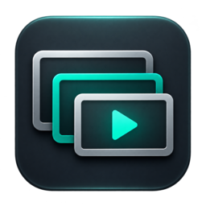
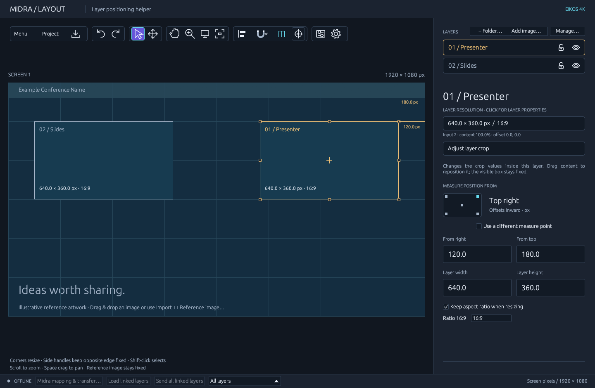
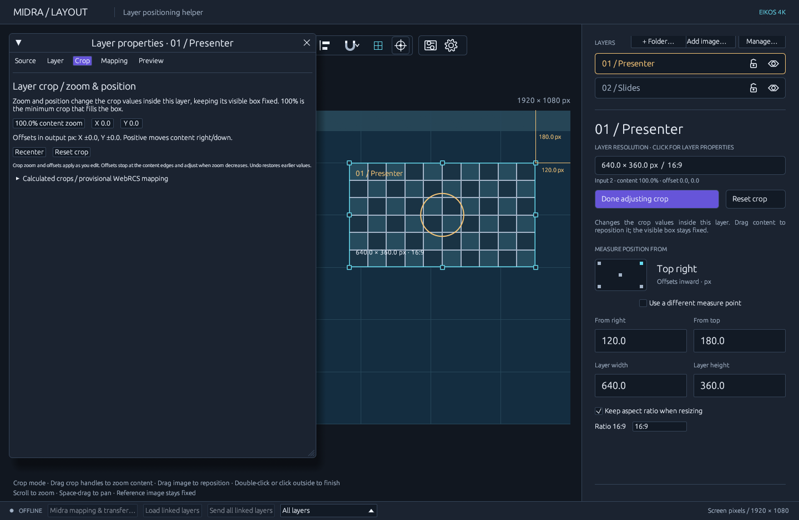

<p align="center">
  
</p>
<h1 align="center">Canvas Pilot</h1>
<p align="center"><strong>Compose your screen layout. Frame every layer. Bring it to the switcher.</strong></p>

<p align="center">
  <a href="#get-started"><strong>Get started</strong></a> ·
  <a href="https://books.dandaedre.com/manuals/canvas-pilot/">Read the manual</a> ·
  <a href="docs/templates/canvas-pilot/README.md">Get templates</a> ·
  <a href="https://proxy.dandaedre.com/gitea/idle-org/canvas-pilot/issues">Report an issue</a>
</p>

Canvas Pilot is a desktop layout editor for presentations and live events. Arrange
slides, cameras and other content as layers on a screen, give them precise sizes
and positions, and crop each picture into place. Prepare everything offline, exchange
layouts with drawing tools, or connect to a supported **Analog Way Midra or Aquilon**
to load and send layer geometry.

Canvas Pilot prepares the layout; your presentation switcher renders the live output.
You can use the editor and file exchange without any connected equipment.

<!-- Screenshot recipe: docs/canvas-pilot/images/README.md#01-workspacepng -->
[](docs/canvas-pilot/guide/quickstart.md)

*Slides + Presenter on a Full HD canvas. This capture predates the Canvas Pilot
rename and still shows the former “Midra Layout” name.*

## From an idea to a screen layout

1. **Set the stage.** Choose your canvas size, start with the example layout, or
   import geometry. Add a reference image to position layers against your design.
2. **Arrange and frame.** Drag, resize, snap and align layers. Enter exact pixel
   measurements, organize alternatives in folders, and adjust the crop visually.
3. **Save or exchange.** Keep an editable project, export a layout for another tool,
   or start from the supplied Full HD and 4K templates.
4. **Transfer when ready.** Connect to a supported device, review layer mappings
   and the Preview/Program destination, then explicitly load or send. Ordinary
   editing stays local.

[Walk through your first layout →](docs/canvas-pilot/guide/quickstart.md)

## Tools for getting the picture right

| Arrange the screen | Frame the content | Work with the device |
| --- | --- | --- |
| Exact sizes and positions | Visual crop, zoom and offset | Load existing layer geometry |
| Snapping, guides and alignment | Reference images and input stills | Review layer-to-device mappings |
| Multi-selection and group resizing | Advanced layer fit and Midra masks | Send selected, folder or all layers |
| Folders, lock/visibility and undo/redo | Saved projects and recovery | Update changed parameters efficiently |

<details>
<summary><strong>See the crop workspace</strong></summary>

<!-- Screenshot recipe: docs/canvas-pilot/images/README.md#03-croppng -->


Adjust the picture inside its layer while keeping the layout in view.
See [formats, crop and precision](docs/canvas-pilot/guide/formats-and-crop.md)
for the available modes and device limitations. This capture also predates the rename.

</details>

## Bring your layout with you

Exchange geometry through **SVG, draw.io, JSON, CSV, DXF, DWG, HTML, PPTX, Figma FIG,
FigCraft and Illustrator AI**. Import review lets you choose what to apply to your
layers; supported formats can also carry optional project metadata.

[**Download all starter templates**](https://proxy.dandaedre.com/gitea/idle-org/canvas-pilot/raw/branch/main/docs/templates/canvas-pilot/canvas-pilot-all-templates.zip)
· [Browse individual formats](docs/templates/canvas-pilot/README.md)
· [Import/export guide](docs/canvas-pilot/guide/files.md)

Format capabilities vary. Native vendor codecs are included in the default build;
Illustrator AI requires the separate VectorCraft CLI. **SVG is the recommended
Illustrator exchange format.** Keep your editable project alongside geometry exports.

## Supported switchers

| Adapter | Recorded validation | Details |
| --- | --- | --- |
| **Midra 4K** | Eikos 4K, firmware 3.3.10; hardware protocol checks | [Device checks and limits](docs/canvas-pilot/device-check.md) |
| **Aquilon / LivePremier** | Standalone AQL Cmax 6.2.x; emulator acceptance on 6.2.79 | [Compatibility and support boundaries](docs/canvas-pilot/aquilon-compatibility.md) |

Support depends on model, firmware and feature. Aquilon physical-output acceptance
remains outstanding; the recorded profile does not imply support for every Aquilon
configuration. See the [connection and transfer guide](docs/canvas-pilot/guide/device.md)
before using a device.

Interested in another switcher? [See the adapter candidates](docs/canvas-pilot/presentation-switcher-adapters.md)
and [open a request](https://proxy.dandaedre.com/gitea/idle-org/canvas-pilot/issues).
Development requires **protocol documentation and a usable emulator/simulator**.

## Get started

Build and run from source with a current stable Rust toolchain and a graphical desktop:

```sh
git clone https://proxy.dandaedre.com/gitea/idle-org/canvas-pilot.git
cd canvas-pilot
cargo run --locked
```

Linux builds need the X11/Wayland and desktop development libraries used by egui/rfd.
Python 3.11+ is needed for the development helpers. See [development and checks](docs/development/README.md)
and [release preparation](docs/development/releases.md) for build and packaging details.

Then follow the [first-layout walkthrough](docs/canvas-pilot/guide/quickstart.md),
or open the [advanced guide](docs/canvas-pilot/guide/README.md) for the full controls.

## Find your way around

[**Full manual**](https://books.dandaedre.com/manuals/canvas-pilot/) ·
[Advanced guide](docs/canvas-pilot/guide/README.md) ·
[Changelog](docs/canvas-pilot/changelog.md) ·
[Tasks and stretch goals](docs/canvas-pilot/plan.md) ·
[All documentation](docs/README.md)

For bug reports, include your OS, application version, steps to reproduce and,
for device issues, the model and firmware. Contributors can start with the
[development guide](docs/development/README.md) and [file/device contracts](docs/interfaces/README.md).

<details>
<summary>Build status</summary>

The badges below become available after the standalone Jenkins pipeline publishes
its first results. See [CI setup and local checks](docs/development/ci.md).

<p align="center">
  <a href="docs/canvas-pilot/changelog.md"></a>
  <a href="docs/development/ci.md"></a>
  <a href="docs/development/ci.md"></a>
</p>

</details>

---

[MIT licensed](LICENSE). Independent software, not affiliated with Analog Way.
Originally part of [beffroi-tools](https://proxy.dandaedre.com/gitea/Beffroi/beffroi-tools);
[earlier history and migration notes](docs/development/migration.md) remain available.
