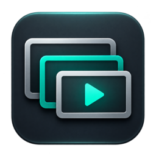
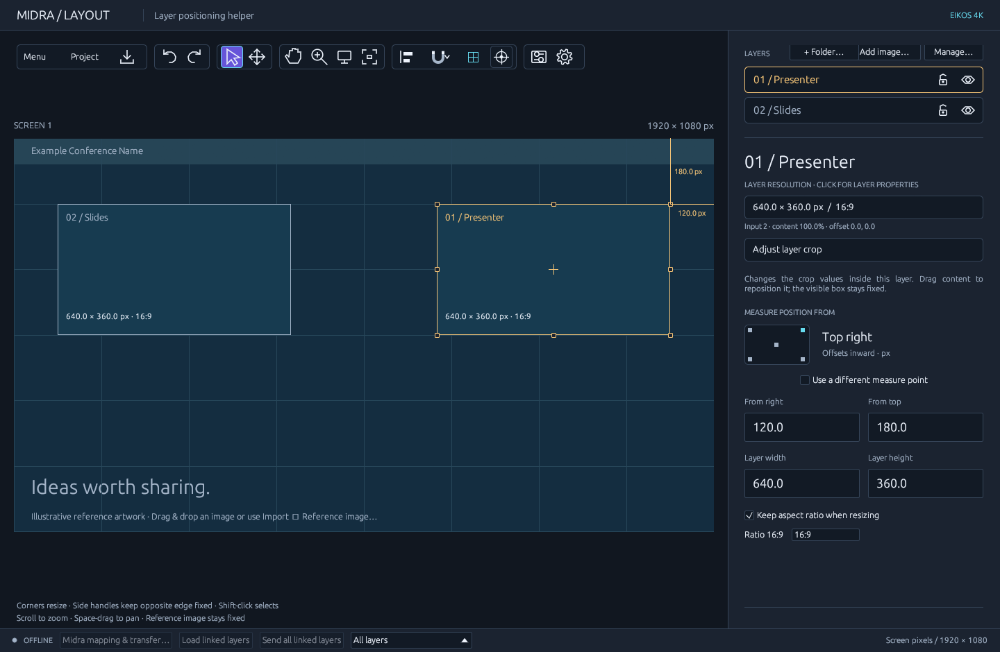
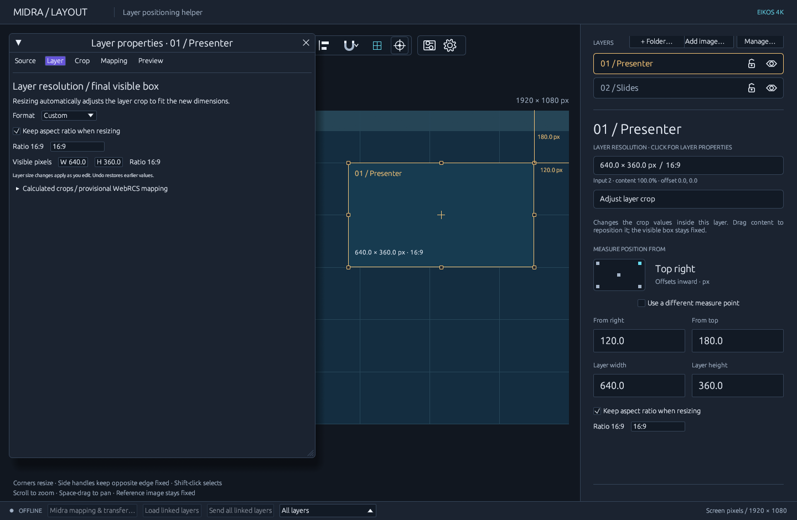
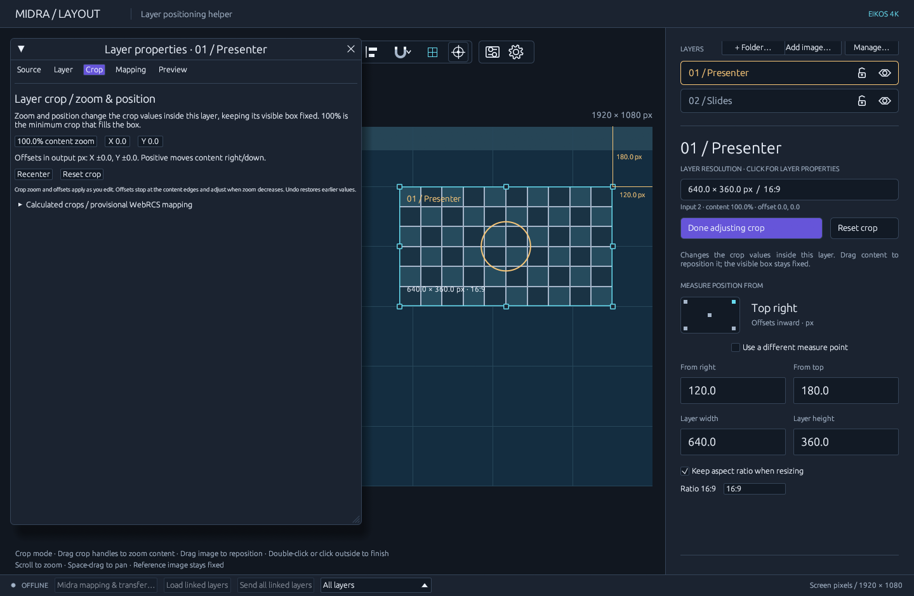

# Canvas Pilot

[Read the full manual →](https://books.dandaedre.com/manuals/canvas-pilot/)



Canvas Pilot (formerly Midra Layout) is an independent project, not affiliated with Analog Way.

Canvas Pilot helps you prepare screen layouts for presentations and live events.
Place video and slide layers on a canvas, check their sizes and positions, and
frame their content before working with the screen processor. You can design
offline, exchange geometry with drawing and presentation tools, and connect to
a supported Midra 4K or Aquilon / LivePremier device when you are ready to review and transfer a layout.

[Quick start](guide/quickstart.md) · [Advanced guide](guide/README.md) · [Starter files for all formats](../templates/canvas-pilot/README.md) · [Changelog](changelog.md)

## Start a layout

Run the desktop app from the repository root:

```sh
cargo run --locked -p canvas-pilot
```

A graphical desktop and a Rust build environment are required; see
[development setup](../development/README.md). No device connection is needed
for local editing.

A new project starts with a 1920 × 1080 canvas and two layers, **Slides** and
**Presenter**. Select a layer on the canvas or in the list, drag it into place,
and use its handles to resize it. Shift-click to select several layers; use
Undo if you want to try a different arrangement.

<!-- Screenshot state and capture instructions: images/README.md#01-workspacepng -->


*The canvas shows the layout; the inspector gives exact dimensions and positions.*

## Position and organize layers

Enter exact pixel positions and dimensions in the inspector, or open **Layer
properties** by clicking the layer-resolution field. Keep the aspect ratio
locked when resizing, align layers, and group related layers in folders. Add
more layers through **Manage…** in the Layers panel.

<!-- Screenshot state and capture instructions: images/README.md#02-layer-propertiespng -->


*Use numeric controls for precise sizing, or work directly on the canvas.*

See [layers and editing](guide/editing.md) for selection, alignment, folders
and group resizing.

## Frame content and use visual references

Open **Layer properties → Crop** to frame the source inside a layer. Crop editing
keeps the visible layer box fixed while you adjust the content within it. You
can also add reference images to the canvas to match an existing screen design.

<!-- Screenshot state and capture instructions: images/README.md#03-croppng -->


*Preview how the source fits inside the layer before transferring a layout.*

See [formats and crop](guide/formats-and-crop.md) and
[canvas and reference images](guide/canvas.md) for the detailed controls.

## Save, exchange or send a layout

- **Save your work:** use **Project → Save project…** for a `.midra.json` file
  that retains the full editor project.
- **Work with another application:** drop a supported geometry file into the window,
  use **Import → Geometry file…**, or **Project → Export → Export layers…**. The [starter-file catalog](../templates/canvas-pilot/README.md)
  has matching Full HD and 4K files in SVG, draw.io, geometry JSON, CSV, DXF/DWG,
  HTML, PPTX, Figma FIG, FigCraft and Illustrator AI. Prefer SVG for Illustrator
  exchange: AI requires a separately installed VectorCraft CLI for both import
  and export. See [AI setup](guide/files.md#illustrator-ai-optional-converter-required).
- **Use a supported device:** connect, review layer mappings, then explicitly load or
  send the chosen layers. Ordinary editing does not send commands to the device.
  Follow the [connection and transfer guide](guide/device.md) and its linked
  hardware-verification notes before using device writes.

For advanced workflows, start at the [advanced guide](guide/README.md).
File schemas and compatibility rules are in the [interface reference](../interfaces/README.md).

[Screenshot capture and update instructions](images/README.md)
