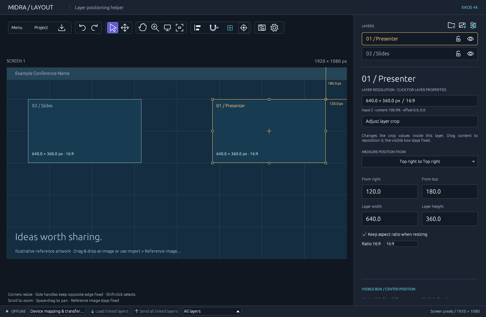
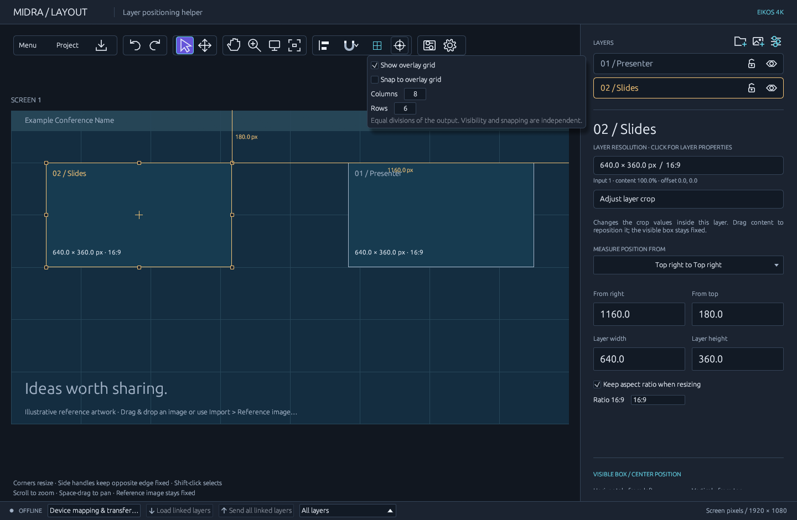

# Canvas and reference images

[Canvas Pilot](../introduction.md) · [Guide contents](overview.md) · [Starter files](../../templates/canvas-pilot/catalog.md)

<!-- Screenshot recipe: ../images/capture.md#advanced-guide-captures -->

*The default layout shows layer bounds, measurements and the screen canvas together. The header still uses the former Midra Layout name.*

## Workspace defaults and limits

New projects start with two local rectangles and two source identities;
you can add more layers and editor inputs.
Output resolution defaults to **1920 × 1080 (16:9)** and can be changed.
The output dialog identifies standard aspect ratios from the current resolution;
nonstandard ratios display as Custom.
The example backdrop is titled **Example Conference Name** by default. Edit it
under **Options → Example backdrop** or **Settings → Reference images**. Changes
appear immediately and save with the project; leave it blank to hide the text,
or use **Reset example title**. Up to 128 single-line characters are allowed.
The title is clipped to the banner and appears only without an imported reference
image, at any output resolution. It is not exported to SVG or sent to Midra.

The initial backdrop is illustrative and adapts to every output resolution/aspect ratio; importing a reference picture replaces it.
Project save/load, ten-format geometry exchange, arbitrary layer collections,
single-level folders and persistent Midra screen/layer links are implemented.
File export offers current/specific/selected/all/visible scopes; device transfers
use All/Selected/Folder. Organization never sends commands by itself.

The Midra connection and mapping/transfer UI supports explicit sends and loads,
with both sizing strategies and Centered crop conversion readback-tested on
Eikos 3.3.10. Program sending is enabled by a manual preference. Ordinary local
editing does not send; linked send is a direct user action. Physical-output
comparison, broader firmware coverage and precise mask rasterization remain
[acceptance/backlog work](../plan.md#remaining-tests).
Visible-box center readouts are distinct from crop-corrected device containers.
Internal precision is retained; views show one decimal and exports whole pixels.

The window can be resized; the screen keeps its aspect ratio, and the right
inspector scrolls on shorter windows. Minimum size is 1000 × 720 logical points.
A graphical desktop session is required to launch.

The Cargo workspace includes this crate in lint, tests, docs and coverage.
Regression tests cover the supplied clipboard, malformed/unsupported input,
corner conversion, group drag/undo, selection boxes, alignment targets, and GUI
paste/focus behavior. Layer-list scrolling uses the wheel or scrollbar so dragging
across list entries cannot accidentally scroll while selecting.

See the [project plan](../plan.md) and
[resolution/cropping specification](../resolutions.md) for the implemented
geometry model and remaining hardware-verification work.

Each layer row has **Lock / Locked** and **Hide / Show** buttons. Locked layers
remain visible but cannot be selected, dragged, nudged, aligned or edited. Hidden
layers keep their geometry and stay in the list, but are excluded from drawing
and selection. Locking or hiding clears that layer's selection; showing it does
not unlock it. These are local session controls, separate from geometry undo/redo
(which can still restore earlier geometry), and never send device commands.

Selected layers use gold outlines, labels, handles and position guides; unselected
layers use muted outlines and labels. Gold in the layer list follows the same
selection state, including when several layers are selected.

### Reference pictures

The screen name and output resolution remain visible above the output when reference
images are loaded; Fit screen includes room for both labels.

Imported images accumulate in a purple **Reference images** section below the
layer list, newest/topmost first. **Add image…** and **+ Add…** accept multiple
files. Use each eye icon to show/hide a guide, the remove icon to delete it,
or right-click **Show only this reference** to switch guides quickly. Double-click
opens that image's settings. Reference rows cannot be dragged, resized, aligned
or sent to Midra; selecting one clears the editable-layer selection.

Removal is also available in **Import → Remove reference image** and the viewport
context menu's **Reference images** submenu, with a picker for the target image.
Images remain fixed behind the layers; their existing explicit fit/opacity settings
remain available. Visible images composite back-to-front. Saves and recovery retain
all images and settings, while background-enabled exports flatten visible guides.
Older single-image projects migrate automatically to the new v10 collection.

The **Import** dropdown groups layer-value imports and screen references.
Layer imports offer destination mapping. After importing a reference picture,
**Import → Reference settings…** opens its visibility, opacity and scaling controls.

Drop one or more PNG, JPEG or BMP images into the window, or choose **Import → Add reference images…**. The image is fixed behind the layers in screen coordinates; zooming
and panning keep it aligned. Layer fills become translucent to reveal the image.
Use the reference window to pick an imported image, hide it, adjust opacity or remove it.

**Fill screen** maps the entire image to the current output resolution. An exact
pixel match needs no warning. Scaling up or down with matching proportions shows
an amber warning; a different aspect ratio (such as 16:10) shows a red **SEVERE
WARNING** because the image is distorted. Neither warning blocks importing or
moving layers. **Fit inside** preserves proportions and centers the image with
empty margins where needed; scaling still produces an amber warning.

Up to 32 images with a combined 64 MiB of file bytes can be stored; dimensions
are limited to 8192 pixels per side or the GPU's texture limit, whichever is
smaller. Invalid imports keep all existing images. Reference images and settings
are saved with the project; their edits are independent of layer undo/redo.

### Optional independent positioning points

**Measure position from** normally uses matching screen/layer points, keeping the
inspector compact. Enable **Use a different measure point** to reveal **To layer
point**. The first selector is the screen origin; the second is the layer endpoint.
For absolute center coordinates, choose screen **Top left** and layer **Center**.

Changing points or turning the toggle off only updates the displayed offsets.
Numeric size and ratio edits keep the selected layer endpoint fixed. Screen-right
and screen-bottom origins keep their existing inward-positive signs; screen
center uses positive right/down. Both points and the toggle autosave immediately to the opened or last-saved project.
Only these choices are written; other edits still need Save. For a new project,
save it once to establish its file. Write failures keep the selection active and show an error.
Older projects open with matched points. Canvas guides show the chosen endpoints.

### Displaying and entering aspect ratios

Layer dimensions and resolution controls show their current width:height ratio
(e.g. **16:9**). A ratio field beside **Keep aspect ratio when resizing** accepts
`16:9`, `4/3`, or a positive decimal such as `1.85`. Press Enter or leave the field
to commit. With the lock checked, width stays fixed and height changes, preserving
the selected position reference (including center). Undo restores the geometry
and crop together. Zero, negative, non-finite and out-of-range results are rejected.

With the lock unchecked, entering a ratio does not resize: it stays ready until
the lock is enabled. The displayed current ratio still describes the actual
sizes. Selecting another layer discards that prepared value. In Layer properties,
manual ratios and presets resize immediately when locked, as do width/height edits.
The Layer tab needs no Apply; pending Source edits still require their own Apply. Unapplied ratio text/targets are temporary UI state, not saved settings
or a separate project constraint. Source content remains proportionally scaled.

### Select, Move, Pan and Zoom tools

The toolbar's **Select**, **Move**, **Pan** and **Zoom** icons are mutually exclusive and
remain selected until another is chosen. **V**, **M**, **H** and **Z** select them when
not typing in a field; hover the icons for help. Grid/Pivot toggle choices are
retained independently.

- **Select (V):** select, move, resize and marquee-select layers using the existing
  controls; crop editing remains available.
- **Move (M):** drag anywhere to move the current selection without changing it
  or resizing. In crop mode, moves the selected layer’s content.
- **Pan (H):** drag anywhere in the viewport to move the camera without editing
  layers or changing selection.
- **Zoom (Z):** click to zoom in around the pointer, Alt-click to zoom out. Drag
  right to zoom in or left to zoom out, anchored at the gesture's starting point.
- **Space-drag / middle-drag:** temporarily pan from any tool. Scroll zoom works
  from every tool. Escape restores the camera if a pan/zoom drag is in progress.

Navigation tool choice survives selection changes and project loads in the current
session; a new launch starts with Select. Pan/Zoom do not alter geometry, crop values
or document history. Existing project saves still preserve zoom/pan values.

### Persistent editing tools

The toolbar’s **Snap ▾** dropdown groups the **10 px grid** and **100 px grid**
icon toggles with the snapping options. Its label shows the effective grid,
including modifier overrides. **Pivot** stays beside it as an independent toggle.
Click again to turn a tool off. Only one grid can stay selected; Pivot can combine
with either. A cyan outline marks the selected toggle; the fill shows its current
effect, including temporary modifier changes. Tooltips explain the shortcuts.
Icons wrap onto another row when the window is narrow.

In double-click crop editing, **Tab** switches between crop and mask (normal crop
and 1:1, Select tool). Tab retains focus navigation in property windows and other
controls. See [mask editing](formats-and-crop.md#masking-without-resizing).

| Held modifier | Temporary effect |
| --- | --- |
| Shift | 10 px grid; disables it if that grid is already selected |
| Ctrl+Shift | 100 px grid; disables it if that grid is already selected |
| Ctrl without Shift | Inverts Pivot on/off |
| Alt | Overrides either grid and inverts ordinary snapping |

A different grid shortcut temporarily replaces the selected grid. Ctrl+Shift does
not invert Pivot, so a selected Pivot tool can combine with the 100 px grid.
Releasing modifiers restores the selected tools, including during a drag. Tools
stay selected across selection changes and project loads in this session; they
are not saved to projects/settings and start off on launch. They affect layer
movement/resize, not numeric edits or crop-content handles.

<!-- Screenshot recipe: ../images/capture.md#advanced-guide-captures -->

*Grid visibility and snapping are independent controls. The header still uses the former Midra Layout name.*

### Overlay grid

The **Grid** toolbar icon opens **Show overlay grid**, **Snap to overlay grid**,
and **Columns / Rows** controls (1–64 each, default 8 × 6). The grid is drawn
above reference images and the sample artwork, below layers, across the full output.
Subdivisions scale with the output resolution and can fall on fractional pixels.

Enable snapping in the magnet menu and **Snap to overlay grid** in the Grid menu to snap layer edges,
centers, resize handles and pivots to these lines. Showing and snapping are
independent; the 10/100 px modifier grids still take precedence. These options
are saved in application preferences. The guide is not included in exports.

### Ctrl resize pivot

With Pivot off, hold **Ctrl** (or select **Pivot**) to show a draggable crosshair on selected layers (center by
default). Drag the marker to place it, including outside the layer; this changes only its saved pivot, not its geometry. Double-click the visible pivot to reset to center.
**Ctrl-drag a layer resize handle** to resize around the fixed pivot. Ctrl can be
pressed/released during the gesture; the result is recalculated from the starting
geometry. With Pivot selected, Ctrl temporarily restores the normal opposite-edge anchor. Escape cancels a
resize or restores the previous pivot placement.

| Resize mode | Pivot behavior |
| --- | --- |
| Individual | Only the dragged layer resizes around its pivot |
| Same handles | Placing a marker sets the same relative pivot on selected layers |
| Mirror horizontally | Placing a marker reflects the partner’s pivot left/right |
| Opposite handles | Placing a marker reflects the partner’s pivot on both axes |

Dragging a pivot snaps within six logical display pixels of the layer's four corners,
four side midpoints and center, even with snapping disabled. Nearby local anchors
win over a grid; elsewhere the active 10/100 px grid or enabled pixel/screen-edge/
visible-layer-edge options apply. Guides show reached anchors/edges/grid lines.
Alt bypasses the nine built-in anchors and grids while retaining its usual
inversion of configured snapping. Release uses the current modifiers.

Moving any marker updates the related markers as above. Changing selection or resize mode preserves stored points. Each layer's own pivot stays fixed
while resizing; unequal sizes retain proportional scaling. Aspect-ratio lock,
snapping (including edge contact), Alt inversion and Undo still apply. A handle
on the pivot's axis cannot resize that axis; move the pivot or use another handle.
Layers do not flip when dragged through the pivot; minimum sizes still apply.
**Ctrl+Shift remains the 100 px grid** (or temporarily disables a selected 100 px grid); it uses pivot anchoring if Pivot is selected. Pivot positions are saved per layer in the project, survive selection changes and reopening, and follow layers when moved. Placement and reset support Undo/Redo. They do not affect numeric sizing. In **Adjust layer crop** mode, Ctrl/Pivot scales the image with its source pixel under the gravity point fixed; the visible layer box stays unchanged. Crop limits stop scaling before revealing empty space, including with outside pivots.

### Resizing with corner handles

Drag a selected layer's gold corner handles to resize it; the opposite corner
stays fixed. **Keep aspect ratio when resizing**, above the viewport, is enabled
by default. Clear it to adjust width and height independently against the reference
picture. The same toggle links numeric width/height edits. Pasted dimensions
remain exactly as supplied by the source.

Dragging a handle in a multiple selection selects and resizes only that layer.
Sizes cannot flip or shrink below one pixel during dragging. Escape cancels;
one Undo restores the complete resize. Locked or hidden layers cannot be resized.

## Reference placement and loading

Reference settings now offer **Native pixels**, mapping each image pixel to one
screen pixel at the screen's top-left, plus X/Y offsets in screen pixels. Offsets
also work with Fit/Stretch. The image is clipped to the output screen. Native
mode does not scale or distort the image, so stretch warnings do not apply.
**Outline-only layers** keeps the reference unobscured while retaining selection
and resize handles; it is also available in viewport options. Crop editing still
shows its source guide. Placement and outline mode are saved in project v4.

Picture import/drop reads and decodes off the UI thread, retaining the current
reference until successful completion. Canceling/removing discards late results;
failed replacements keep the current image. Decoder work is serialized to bound
peak memory. Minification uses linear filtering, magnification nearest-neighbor.
Project/recovery reads and embedded reference decoding also run in a worker;
the editor is installed atomically after all images validate.

Resize snapping now uses the same preference and Alt inversion as movement snapping.
It preserves opposite anchors, aspect ratio and group-resize proportions. Guides
appear only when the resulting handle reaches the target; crop-content gestures
remain unsnapped. At 2 logical pixels per screen pixel, adaptive coordinate rulers
appear; at 8, a pixel grid appears. Guide drawing is limited to the visible region.

Every exchange format also offers **Specific layer…**, listing every local layer, including
hidden/locked layers. Choosing one explicitly exports its geometry without
changing visibility or selection. No device mapping or send is implied.

Midra explicit fit modes are available behind **Crop → Advanced layer fit**.
Their container/image geometry is previewed locally; exact scaler rasterization
remains an [engineering stretch goal](../midra-fit-precision.md).
