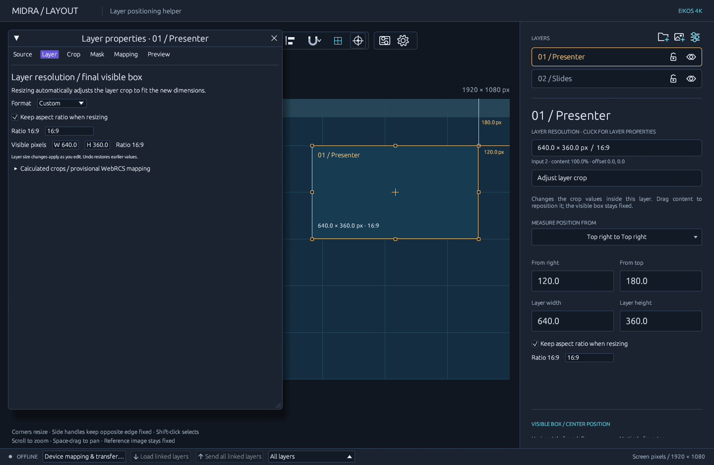

# Layers and editing

[Canvas Pilot](../introduction.md) · [Guide contents](overview.md) · [Starter files](../../templates/canvas-pilot/catalog.md)

## Layer folders

The Layers sidebar groups folder members under collapsible folder rows.
Click the chevron to expand/collapse; click the folder name to select its visible,
unlocked layers. Shift-click adds/removes its contents from the selection.
Click empty space in the Layers list (including the gutter beside folder contents) to deselect all layers.
Double-click a folder or layer name to rename it. Folder eye and lock icons apply
to every member; Undo restores each member's previous state, including mixed states.

Use the **Create folder** icon to create an empty folder, regardless of selection. Drag a layer onto a folder
name to move it inside, or onto **LAYERS** to return it to the root. Dropping on
another layer also changes stacking order and adopts that layer's folder.
Drag folder names above/below another folder to reorder all their layers as one
block. Right-click offers rename, selection, visibility, locking, moving up/down,
and **Ungroup folder** (keeps the layers). A layer's right-click **Move to folder**
menu also offers existing folders, the root, and a new folder. Right-click a selected layer in either the list or viewport to move all selected layers together; right-click an unselected layer to move only that layer.

Folders are local, single-level groups. Explicitly created folders survive empty,
can be renamed or deleted, and are saved with their collapse state. Legacy groups
created only by layer labels still disappear when empty. Empty folders appear
after the layer-backed groups; stacking movement applies to folders with layers. The existing
**Manage layers and folders** remains available for bulk name/folder editing. Grouping does
not affect device links or source assignments. All document edits support Undo.

<!-- Screenshot recipe: ../images/capture.md#advanced-guide-captures -->

*Use the Layer tab for precise dimensions; the inspector keeps the selected layer in view. The header still uses the former Midra Layout name.*

## Move and edit layers

- Click a layer or its list entry to select it alone. **Shift-click** toggles that
  layer in the selection. Selection does not change stacking. The top row of the layer list is the frontmost layer. In overlaps, the frontmost selectable
  layer wins; the list lets you
  reach the lower layer. Clicking empty canvas clears selection; Shift-clicking
  empty canvas preserves it.
- **Left-drag on empty canvas** draws a selection box, selecting every rectangle
  it intersects, in either drag direction. **Shift-drag on empty canvas** draws an additive box,
  including when starting over a layer. Escape cancels the box and restores the
  previous selection.
- Drag a selected layer to move the whole selection together; dragging an
  unselected layer selects and moves it alone. Movement uses whole-screen-pixel
  deltas and preserves fractional starting positions, sizes and relative spacing.
  Drag a corner handle to resize that layer, or use the single-layer numeric fields.
- Arrow keys move the selection by **1 px**; Shift-arrow moves it by **10 px**.
- Open the **Measure position from** dropdown to choose a corner or the center marker. The **From · screen** and **To · layer** squares sit side by side; To follows From until **Use a different measure point** is enabled. The closed dropdown summarizes both points. Center offsets measure layer center from screen center (positive right/down); zero centers the layer. Switching reference changes the displayed
  offsets without moving the layer. Position and size edits apply when you leave
  a field or press Enter. Resizing preserves that
  reference point's offsets. Invalid values leave the document unchanged.
- **Escape** cancels a drag or restores uncommitted numeric fields. In the paste
  dialog it asks whether to Apply or Discard detected values. Group drags cancel atomically.
- The history toolbar icons (**Undo/Redo**) or Ctrl/Cmd-Z, Ctrl/Cmd-Shift-Z (also Ctrl/Cmd-Y) reverse
  edits. Each drag, alignment, applied paste or numeric edit is one step; retain 100 undo
  records. View changes and selection are not document edits.
- Scroll over the viewport to zoom around the pointer. Space-drag or middle-drag
  pans. In the compact toolbar’s view group, **Fit screen** resets the view and
  **Zoom to selection** frames the entire selection. A view warning appears only when a visible layer is completely out of view; select it in the layer list to frame it. The inspector separately flags layers partly or entirely beyond the output screen and suggests alignment or position edits. A divider separates view tools from Undo/Redo. Hover an icon for its label.
  Camera changes do not modify coordinates. Off-screen layers retain their exact
  coordinates, display a warning and remain selectable through the layer list.
- **Copy position values** (or **Copy selected positions** for multiple layers)
  copies labeled plain text with each selected layer's center position and
  dimensions. **Ctrl/Cmd-C** does the same when the viewport has focus. These
  values can be pasted back using **Ctrl/Cmd-V** or **Paste layer(s) values**, with
  the usual destination mapping and exact layer-count requirement. Center values
  are converted back to top-left bounds; whole-pixel export rounding still applies
  (an odd width/height can produce a half-pixel top-left). Source formats and crop
  offsets are not copied. Crop zoom is included separately as a percentage and
  can be toggled on paste. This is not a native WebRCS clipboard payload.

Right-click a layer for **Source properties**, **Layer properties**, **Crop properties**, **Configure capture**,
**Adjust layer crop**, alignment, **Copy layer values**, **Paste layer values**, and lock/hide actions.
Paste reads the clipboard and opens the existing value/mapping review before applying changes. Right-clicking a layer
already in a selection keeps the whole selection and offers **Resize together**.
Right-clicking an unselected layer selects it first. Locked/hidden layers remain
protected; use the layer list to unlock/show them. Right-click empty canvas for
**Output format**.

## Resize selected layers together

Select multiple layers, then choose **Same handles**, **Mirror horizontally**, or **Opposite handles** in the
right-hand inspector’s resize dropdown. Drag a corner or side handle on any
selected layer to scale the selection together. All three modes use **equal
proportional scaling**, not equal pixel additions: a 10% width increase applies
to every selected layer’s own width.

- **Same handles** uses the matching handle on every layer.
- **Mirror horizontally** requires exactly two layers. Left/right handles are
  mirrored: bottom-right matches bottom-left, and top-right matches top-left.
  Top and bottom midpoint handles remain top and bottom respectively.
- **Opposite handles** requires exactly two layers. The other layer uses the
  opposite handle: right/left, top/bottom, and diagonally opposite corners
  (bottom-right matches top-left). This was previously called Mirror resize.
- Each layer keeps the opposite edge or corner fixed. With aspect ratio locked,
  both dimensions use the same scale; otherwise width and height scale
  independently. Side handles affect only their axis when the ratio is unlocked.
- Minimum sizes constrain the shared scale. Invalid geometry rejects the whole
  update. Crops adjust with sizing, and one Undo restores all layers and crops.
- The resize mode survives selection changes, Escape and Undo/Redo, and is saved
  with the project. Opening a project restores its saved resize mode. A single selected layer resizes
  individually; reselecting multiple layers reuses the chosen mode. Mirror and
  Opposite still require exactly two layers. Choose **Resize: individual layer**
  to change back explicitly. **Escape** cancels an active drag without resetting
  the choice. Locking/hiding during a drag cancels the entire gesture.

## Align selected layers

Open the **Align selected layers** icon menu beside the view/history toolbar.
The **Align to** dropdown automatically uses **Screen (one selected layer)**
for a single layer and **Selected layers** (their combined bounds) for multiple
layers. Screen alignment uses the current output resolution.
It also lists **Layer 1: Presenter**, **Layer 2: Slides**, and any future layers.
An explicitly chosen reference layer takes precedence, stays fixed and does not
need to be selected. There is no separate Screen option for multi-selection.

In **Adjust layer crop** mode, alignment positions the zoomed content inside the
selected layer's visible box. Left/top/right/bottom align the corresponding
content edge to the box edge; center resets that axis's offset. Corners align both
axes in one Undo step. Zoom, source proportions and layer geometry stay fixed;
leaving crop mode restores normal layer alignment and its previous target.

The compact icon grid offers four corners, top/bottom/left/right edges, center
on both axes, and separate horizontal/vertical centering. The top-right button
centers horizontally (X); the bottom-right button centers vertically (Y). Edge buttons change
only their axis; corner buttons change both axes. Hover an icon for its label.
Every action preserves layer sizes and is one undo step, including corner moves.
The menu also works with one selected layer and a different reference layer.
The inspector lists each selected layer's resulting center coordinates; select
one layer for numeric size editing, or use a shared resize mode for the selection.
Paste/import accepts the full selection.

Text inputs receive normal text paste and arrow navigation while focused; they
never interpret these actions as geometry import or layer movement. Paste preview
identifies every destination explicitly and applies the mapped selection together.

## Layer management

Use **Layers → Manage layers & folders…** or the **Manage layers and folders** icon above the inspector list.
Add layers, select one or more to remove, and edit names/folder labels. Names and folders commit on Enter or focus loss. These
changes support Undo/Redo; at least one layer must remain. Folder filtering helps
manage the list without changing stacking order. Lock/Show remain local, undoable flags.
Use each row’s **↑ / ↓** buttons in **Layers & folders** to reorder immediately,
or drag a layer name in the right-hand list and drop above/below another row.
A cyan line marks the drop position; Escape or releasing outside the list cancels.
Choose **All folders** to enable the manager’s reorder buttons. Hidden/locked
layers can be reordered without changing their flags. Each move is one Undo step;
pending names/folders follow their layer. The list reads front-to-back (top row on
top); saved arrays and SVG read back-to-front. Moving a row up brings it forward;
moving down sends it backward. Selection does not change stacking. Reordering never changes geometry, source assignments or Midra links,
and never sends to the device.

Stable IDs survive removal and are independent of Midra layer numbers. Group
movement, alignment and Same-handles resizing work across the selection;
Mirror/Opposite resizing still require exactly two layers.

Projects support migration from older supported versions.
Every format’s **Selected layers** scope exports just the current selection,
including a single layer. All/visible export remains available.

## Viewport context menu

Right-click a layer for rename/folder actions, copy/paste, crop adjustment,
aspect-ratio locking and alignment. **Properties** groups the Source, Layer,
Crop and Mapping windows. **Input preview & crop guides → Configure capture…**
opens the Preview tab; an existing preview also offers an enable toggle and crop
guide opacity directly in that submenu. Opacity is adjustable only with an
available preview image. Input selection stays in the window, so long input
lists do not interfere with the context menu.

Lock, Hide and Delete follow the editing controls. Snapping, Reference images
and Output format are together at the bottom. Multiple selection retains its
Resize together and alignment actions.
