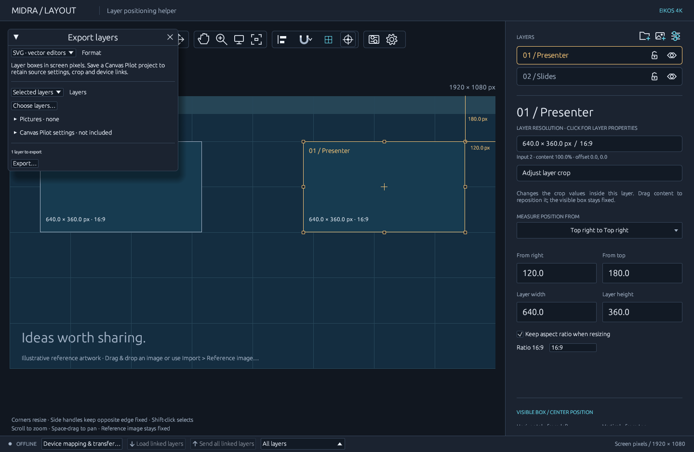

# Import, export and project files

[Canvas Pilot](../introduction.md) · [Guide contents](overview.md) · [Starter files](../../templates/canvas-pilot/catalog.md)

Choosing an exchange format? See the [file and clipboard feature matrix](format-matrix.md)
for naming, crop, pictures and editable-settings support.

The toolbar has adjacent **Import** (arrow into a box) and **Export** (arrow out
of a box) icons. They open the same import/export menus available from Menu;
opening a menu does not read or write device values. Hover for the label, or
turn on toolbar icon names in Options.

## PDF pages and documents as reference pictures

Choose **Add reference images** from the reference list or Import menu, then
select a picture or supported document. For documents, choose **Artwork** (when
available) or **Layout boxes**, select the page/slide/frame and resolution, inspect the preview,
and click **Add reference**. Repeat to add another page. Closing the dialog
leaves the document unchanged. PDF drops open this dialog directly; other exchange
files normally open geometry review, unless the **Reference image** window is open.

| Source | Artwork reference |
| --- | --- |
| PDF | Built-in page rendering; no external application required |
| SVG | Built-in rendering of artwork, text and embedded images |
| PPTX | Slides converted locally by an installed LibreOffice |
| draw.io / XML | Pages converted locally by an installed draw.io Desktop |
| FIG / FIGCRAFT | Built-in FigCraft artwork rendering in the normal build; best effort for native FIG |
| Illustrator | Artboards converted by the existing optional VectorCraft CLI |
| Geometry JSON / Canvas Pilot HTML | Layout artwork including embedded PNG images; HTML uses the exchange data, not custom CSS/scripts |
| CSV / DXF / DWG | Layout boxes from supported geometry, with labels; not a full CAD drawing renderer |

**Layout boxes** is available for every compiled geometry importer. It draws the
detected rectangles and their labels, fitted to their bounds; it does not reproduce
original artwork. This is useful when a converter is unavailable. For a faithful
reference from an unsupported drawing feature, export PDF or SVG from its editor.

PDF pages render on a white background; SVG transparency is retained. References
preserve proportions by default and contain the rendered PNG, so saving and reopening
a project needs neither the source document nor its converter. These are static
pictures, without editable text, automatic layer detection or playback.

The default longest edge is 1920 px; choose up to 4096 px for detailed artwork.
Input files are limited to 64 MiB, PDFs to 256 pages, and the existing 32-reference /
64 MiB combined image limits still apply. Render only the pages you need. Export an
unlocked copy of password-protected PDFs. Inspect font substitutions and complex
PDF effects in the preview; SVG external linked images are omitted.

For PPTX conversion, install LibreOffice and put `libreoffice` (`soffice.exe` on
Windows) on PATH, or set `CANVAS_PILOT_LIBREOFFICE` to the executable. For draw.io,
use `drawio` (`draw.io.exe` on Windows) or `CANVAS_PILOT_DRAWIO`. Executables beside
Canvas Pilot or in its `bin/` folder are also found. On macOS, the executable may
be inside the installed application's `Contents/MacOS/` directory. Conversion uses
temporary copies and has a 60-second timeout; source files are never overwritten.
These converters are optional and are not bundled. At startup Canvas Pilot looks
for executable files using the configured environment override, its own folder
and `bin/`, PATH, and common macOS/Windows installation folders. An invalid explicit
override is reported rather than silently using another installation. Discovery
does not launch the applications or verify their versions. The same detected path
is used for conversion; runtime failures are still reported.

Open **Application menu → Software integrations…** to see each tool, its status,
path and the features it enables. Missing integrations remain listed there for
setup, but their unavailable actions are hidden: PPTX/draw.io references default to
**Layout boxes** without an Artwork choice, and Illustrator is omitted from file
filters and export choices when VectorCraft is missing. Built-in geometry import
and export remain available for PPTX/draw.io. Restart Canvas Pilot after installing
software or changing an override; discovery is a session snapshot, not a live
connection. No executable paths are saved in the project.

Draw.io Desktop may require a graphical desktop session. The existing VectorCraft setup is described below.

## Paste layer values and import geometry

Check the [clipboard feature matrix](format-matrix.md#clipboard-matrix) for your
application: its file and copy/paste workflows can support different features.

Drop SVG, draw.io/XML, geometry JSON/CSV, DXF/DWG, HTML, PPTX, FIG, FIGCRAFT or Illustrator files into
the window to open the same geometry review as **Import → Geometry file…**.
Native codecs still require their normal build options/dependencies. Filename
extensions are case-insensitive; PNG/JPEG/BMP and PDF drops open as references.
While the **Reference image** window is open, supported document drops also open
as references instead of layer geometry.
Multiple geometry files appear in the **File / page / frame / slide** chooser;
choose one document/page to map at a time. Reading runs in the background, and
nothing changes in the layout until Apply. The entire geometry drop is limited
to 16 MiB; a failed document leaves the batch unapplied and reports its filename.

1. Copy layer values or geometry and use **Import → Clipboard values** or
   **Ctrl/Cmd-V** with the viewport focused. Alternatively use **Import → Geometry
   file…** or drop a supported file. These entry points share one mapping review.
   If entering text manually, paste it and click **Review pasted values**.
2. Once geometry is detected, the review only shows the loaded data, mapping and
   import options. **Clipboard data** is a collapsed, read-only preview; there are
   no additional file/paste buttons inside the review. Multiple documents/pages
   retain their page chooser.
3. Under **Destination layers**, choose **All layers**, **Selected layers**, or
   **Folder: …**. Existing selection initially scopes and pre-maps the import;
   with no selection, choose destinations individually from All layers. Changing
   the scope never changes canvas selection and preserves mappings still in scope.
   Hidden/locked layers are excluded. Each source item has a prominent destination
   dropdown and collapsed **Geometry · before / after** details. Uncheck **Include
   item** to skip an item. Each included item must map to a different destination;
   fewer source items than destinations are fine. Duplicate or missing mappings
   block import. Other layers stay unchanged.
4. Choose **Format (width / height)** and **Position** independently. For Canvas
   Pilot copies, expand **Appearance** to choose **Crop & fit** and **Blanking**;
   the collapsed heading shows what will be applied. Legacy text offers **Crop
   zoom** when present. Available values start enabled. Unchecked values retain
   destination settings; resizing may adjust its existing crop. Outline bounds
   are offered only when the source includes an outline. At least one available
   geometry, appearance or name value must be enabled.
5. Click **Import mapped values** to update the mapped layers in one undo step.
   Cancel leaves all layers unchanged. Invalid geometry
   blocks the whole batch, without partial changes.

The workspace supports 1–256 layers; the import review handles all selected
layers rather than choosing one rectangle from a larger clipboard selection.

### Rename destination layers

Enable **Rename destination layers** in the mapping review to use names from the
copied or imported shapes. It starts unchecked and appears only when included
items have names. The review shows each proposed name. To rename only, uncheck
Position, Format and any appearance options. Unnamed items keep their current
names; folders, layer IDs, stacking order and device links remain unchanged.
Names must contain 1–128 characters. An invalid name blocks the whole operation;
renaming and geometry/appearance changes undo together.

| Source | Names used when available |
| --- | --- |
| Canvas Pilot clipboard | Actual layer name, without the displayed ID prefix; new copies only |
| SVG, including Figma/Illustrator SVG text | Inkscape label, shape title, `data-name`, then explicit SVG ID; nearest named group if the shape has none |
| draw.io XML | Cell label; supported well-formed HTML labels are reduced to plain text |
| Geometry JSON / CSV | `name` field |
| HTML geometry | `data-name` attribute |
| PowerPoint | Shape name |
| Figma / FigCraft file | Node name |
| DXF / DWG | CAD layer description, otherwise CAD layer name |
| Illustrator file | Names retained by its SVG conversion |

An editor may omit names or emit generated SVG IDs. Review the proposed names
before applying them. Canvas Pilot never turns its own generated review labels
(such as “rect 1”) into names. Draw.io-rendered SVG cell IDs and older Canvas Pilot
clipboard labels are not treated as source names. File names and document titles
are not layer names. This works within the existing supported geometry profiles;
it does not add support for arbitrary artwork.

### Canvas Pilot layer clipboard

**Copy layer values** preserves exact geometry, crop edges and offsets, all fit
modes and blanking masks. The clipboard still begins with readable values; an
appended versioned payload holds the exact data. Editing only the readable summary
does not change what Canvas Pilot pastes.

To copy only appearance, uncheck Position and Format. Expand **Appearance** to
choose Crop & fit, Blanking, or both. Source assignments, device mappings and
input settings stay unchanged. Crop & fit requires matching source dimensions
after local input crop; normal crop also needs compatible box proportions. The
review explains mismatches before allowing import. Match the source dimensions,
include Format, or uncheck Crop & fit as appropriate. Blanking works independently
of source dimensions. A failed batch changes nothing; a successful paste undoes
in one step.

Older normal-crop text remains supported, with its optional zoom. It cannot supply
missing offsets or masks. The new full payload needs a current Canvas Pilot
version; use a project or snapshot for references, inputs and other document state.
See the [clipboard contract and example](../../interfaces/canvas-pilot-clipboard.md).

### SVG bounds

SVG import accepts square-corner rectangles and simple closed rectangular
paths/polygons, including translated/scaled groups and inline styles. It applies
page dimensions and `viewBox` transforms, using CSS units at 96 px/in. Coordinates
are relative to the SVG page; exporting only a selection may lose its original
document position. This geometry-import action uses bounds. For the complete
SVG artwork, use **Add reference images** instead.

A first full-page rectangle or image is marked as a possible background. Uncheck
**Include full-page background** to exclude it from the count and mapping. This
is explicit: a full-page rectangle can also be a real layer. Image backgrounds
must be excluded; their contents and external links are never loaded.

Midra SVG v2 placeholder images import as one layer box each; their image content
is not decoded. Other visible artwork, rotation/skew, rounded rectangles, clipping, masks,
filters, stylesheets, and unsupported SVG features are refused with an error.
Hidden objects and definitions are ignored. Export simple rectangles with inline
styles for predictable results. Files are limited to 16 MiB, 256 rectangles plus an optional background, and
64 levels of nesting. SVG imports retain the same outline and position-only
choices as draw.io imports.

### Figma SVG clipboard text

The supplied [Figma SVG sample](../../../crates/canvas-pilot/tests/fixtures/figma-rectangles.svg)
works through the existing SVG/value paste parser: two 640 × 360 rectangular
paths at (0, 0) and (1040, 0), including their matrix translations and order.
Paste SVG text and review the detected shapes in the mapping dialog.
Figma copy/paste was manually reviewed on 2026-11-15. This validates
the tested SVG workflow, not every native binary/HTML clipboard format.

### Illustrator SVG clipboard text

The supplied [Illustrator SVG sample](../../../crates/canvas-pilot/tests/fixtures/illustrator-rectangles.svg)
works through the existing SVG/value paste parser. Its two 1814.174 × 1020.473
rectangles retain fractional positions (0.354, 0.354) and (395.791, 461.357).
Enabling outline inclusion adds the centered 0.709-unit stroke to their bounds,
producing 1814.883 × 1021.182 boxes. Stroke colors are not imported as artwork
through this geometry workflow. Illustrator copy/paste was manually reviewed
on 2026-11-15; other native clipboard formats are outside this validation.

For QCAD and PowerPoint, use file exchange; no clipboard-export integration is
planned for these workflows.

### draw.io clipboard

The draw.io adapter accepts single-page `.drawio`/`.xml` files (including native
compression) and raw or once-percent-encoded `mxGraphModel` clipboard XML, like
[the supplied clipboard fixture](../../../crates/canvas-pilot/tests/fixtures/drawio-rectangle.txt).
Draw.io coordinates map **1:1 to screen pixels**, with a top-left origin. This is
an explicit import convention; no page-scale, physical-unit or viewport-size
conversion is inferred. Missing X/Y means zero. Decimal dimensions are preserved.

The supplied example imports **X 12, Y 271, width 945, height 531.58**. The center
is **484.5, 536.79**. The visible box has its exact imported ratio; it is not rounded
or coerced into a 16:9 preset. “Format” here means the visible rectangle's width,
height and aspect, not native source format or advanced cropping.

**Include outline in bounds** is off by default on each paste. For an outline of
width `s`, enabling it subtracts `s/2` from X and Y and adds `s` to width and
height, preserving the center. This follows the half-stroke expansion in
[mxGraph's bounding-box calculation](https://github.com/jgraph/mxgraph/blob/master/javascript/src/js/shape/mxShape.js).
Your sample's 5 px outline gives **950 × 536.58 at (9.5, 268.5)**. Only the bounds
are imported; no border is drawn or configured on the device.

The option is disabled for position-only paste: that mode uses the original
geometry's top-left and keeps the target layer's dimensions. Zero-width,
`strokeColor=none`/`transparent`, zero stroke opacity and zero overall opacity
produce no outline expansion. A missing width uses the standard 1 px default;
the detected width is shown in the preview. Each rectangle in a multi-object
paste uses its own width. Shadows, sketch effects and raster antialiasing fringes
are not included. Invalid thickness/opacity values or bounds beyond the
application limits are rejected without changing the document.

The adapter otherwise ignores colors, text, style aspect locks and other
appearance settings. It currently rejects grouped/nested geometry, connections,
nonrectangular shapes, relative coordinates, alternate bounds, rotated/flipped
objects, named/inherited styles, wrapped objects and compressed `.drawio` files.
Mixed selections containing unsupported objects are rejected as a whole. Invalid
input makes no document changes. Text is limited to 16 MiB; geometry must have
finite coordinates within ±1,000,000 px and positive sizes up to 1,000,000 px.
These are application limits, not verified Eikos limits.

Draw.io also exposes raw page XML through **Extras → Edit Diagram**, as described
in its [source-editing documentation](https://www.drawio.com/docs/manual/advanced/diagram-source-edit/).
Support is covered by the supplied clipboard data and regression fixtures. Draw.io
copy/paste was manually reviewed on 2026-11-15.

## Save, open and export

Use the **Project** toolbar menu to **Save project…** or **Open project…**.
**Save project…** suggests a `.pilot.json` name. **Open project…** lets you try
any `.json` file, including legacy `.midra.json` projects; the contents must be a
valid Canvas Pilot project. Existing files are not renamed automatically.

Projects use readable, versioned `.pilot.json` files and preserve applied output,
inputs, layer bounds/crops, source assignments, locks, visibility, selection,
viewport preferences, and all embedded reference images. Apply pending edits
before saving. Opening asks before replacing current work and starts a fresh
undo history. Existing files require confirmation before replacement.

The [starter-file catalog](../../templates/canvas-pilot/catalog.md) contains all eleven
exchange formats, with two layers for 1920 × 1080 and 3840 × 2160 canvases.

**Menu → Export → Export layers…** opens one shared window:

1. Choose the **Format**.
2. Choose **Layers**: Selected layers, All layers, Visible layers only, or Specific
   layer. With Selected layers, **Choose layers…** lets you adjust the selection.
3. Click **Export…** and choose a file. The layer count previews the scope;
   selecting one layer keeps its original screen position and full-screen canvas.

Optional groups start collapsed. **Pictures** contains **Include background layer**
and **Include placeholder pictures**. Their heading shows what is included even
when collapsed. CSV and DXF offer only a background rectangle, with no picture
controls. **Canvas Pilot settings** contains the optional editable snapshot;
its heading also shows whether inclusion is enabled. For everyday geometry
exchange, leave both groups at their defaults.

Import a supported format with **Import → Geometry file…** or paste its text, then
choose a slide/page/frame where applicable, then map detected layers to destinations.
PPTX uses 96 pixels per inch; FIG/FIGCRAFT use native pixels. Illustrator file exchange requires a separately
installed `vectorcraft-cli`; its artboards appear in the same canvas selector.
Import/export runs in the background and reports conversion failures without
modifying the project. Backgrounds are automatically ignored;
placeholder images each count as one layer. draw.io files saved with compression
are supported. SVG rendered by draw.io Desktop is recognized through its retained
cell IDs; generated HTML labels and raster text fallbacks are ignored. Draw.io
may crop and rebase that SVG unless the exported diagram includes the background
layer. These exports round-trip whole-pixel visible-box geometry, not
source/crop settings; the separate `.pilot.json` project format preserves the full project. See the
[geometry exchange contract and native draw.io checks](../../interfaces/canvas-pilot-exchange.md)
and [project save contract](../../interfaces/canvas-pilot.md).

Visual crop mode also provides **Reset crop** beside **Done adjusting crop** in
layer properties. It restores 100% content zoom and centered offsets, keeps the
visible box and source/input crop unchanged, and leaves visual editing active.
The reset is undoable.

The toolbar’s **Viewport options** cog contains **Keep aspect ratio when resizing**
and **Show source patterns on other layers while cropping**. Both apply immediately
and are preserved in saved projects. Crop editing always previews source content
and keeps its proportions, independently of these layer/view preferences.

The toolbar’s **Import** button uses a downward arrow into a tray. Hover for its
label; its dropdown contains SVG, clipboard values, and reference-image actions.

<!-- Screenshot recipe: ../images/capture.md#advanced-guide-captures -->


*Choose a format, artwork options and which layers to export in one window. The header still uses the former Midra Layout name.*

## Choose layers inside import and export menus

You can choose layers without returning to the viewport:

- **Import → Choose destination layers…**, and the same picker inside the
  geometry review, select the destinations. Paste and file import can open
  with nothing selected: map each detected rectangle directly to an available
  layer using its destination dropdown. When using a selection, there must be at least as many chosen destinations as imported rectangles
  after ignoring a background. Map to any subset of them; other layers stay
  unchanged. Duplicate mappings and empty imports remain invalid.
- In Export layers, choose **Selected layers** and use **Choose layers…** to select
  the group. **Specific layer** remains available for individual layers,
  including hidden layers.
- Midra send preparation has **Choose editor layers to send…**, followed by a
  device-destination dropdown for each chosen layer. It can open online with
  nothing selected. Sending requires explicit review and clicking **Send mapped layers**.
- Midra import retains its independent per-device-layer destinations, including
  **New layer** and **Do not import**.

The shared pickers update the viewport selection. Hidden/locked layers are labeled
and disabled in these pickers; choosing layers changes no geometry. Full project
save/load and screen reference images are document-wide operations, so they have
no layer mapping.

**Midra mapping & transfer…**, beside ONLINE/OFFLINE and in **Export**, opens the Midra export configuration without sending, even when layers already have saved links. Choose layers, destination mappings, Preview/Program and sizing, then click **Send mapped layers** to send. The action is disabled offline or during transfers. Sending writes geometry, pulses the WebRCS preset-update command, and verifies geometry readback. Only applied editor values are sent.

Layer rows use padlock and eye icon buttons for locking and visibility, with tooltips and highlighted locked/hidden states. Double-click a layer name in the right-hand list to rename it. Enter saves, Escape or Cancel discards the edit; names must contain 1–128 characters. Renaming preserves the layer ID and folder and supports Undo.

Hold **Shift** while moving or resizing layers to snap to a **10 px grid**;
**Ctrl+Shift** uses a **100 px grid**. A matching selected grid tool is temporarily disabled instead; a different shortcut temporarily switches grid size. These grids override ordinary
pixel/edge snapping, even when snapping is disabled in Settings. **Alt**
overrides both grids and temporarily inverts ordinary snapping. The modifier state on release determines the final position.
Grid coordinates are screen pixels measured from the screen's top-left, independent
of viewport zoom. Group movement snaps the selection's bounding top-left and keeps
relative spacing. Resize snapping keeps opposite anchors and group proportions;
free corners snap both axes, while ratio-locked corners snap one driving axis.
Cyan guides mark reached grid lines. Numeric entry, crop-content gestures and camera
panning are unaffected. Shift-click still toggles selection; Shift-drag on a layer
moves it on the grid, and Shift-drag on empty canvas adds a selection box.
This replaces the previous Shift-to-invert-resize-snapping shortcut.

With snapping and layer-edge snapping enabled, resizing in **Mirror** mode snaps
the two moving inner edges into exact contact, including unequal-sized layers.
**Opposite** mode also supports vertical contact. A guide marks the meeting edge;
anchors and aspect-ratio settings are preserved. Move beyond the snap radius to
continue resizing, or hold Alt to temporarily invert snapping. Shift/Ctrl+Shift grid overrides remain.

Midra layer lists omit unassigned source slots (`NONE` or empty). Assigned inputs remain listed even if the layer is off. The exporter defaults to Preview and hides Program until **Settings → Midra integration → Allow sending to Program** is checked. This preference is saved automatically; turning it off returns the exporter and quick Apply action to Preview.

Destination choices in **Midra mapping & transfer…** now save immediately on the editor layer and support Undo. Save the project JSON to keep links across sessions. Links include screen and layer IDs and survive refreshes and selection changes. Choose the empty destination on the linked screen to unlink. The direct send button is available beside Midra mapping & transfer and in Export; in **All layers** scope it includes unselected, hidden and locked linked layers, grouped by screen. Its label changes to **Send selected links** or **Send folder links** in those scopes. Midra mapping & transfer… opens mapping configuration for the current scope. Preview/Program and sizing still use the current export options.

Every explicit layer-layout send includes WebRCS’s preset apply pulse (`xUpdate` false → true). This applies staged geometry when automatic updates are disabled, including a repeat send where WebRCS already shows the desired values.

**Send all linked layers** sends immediately using saved links and the current target and sizing settings, without opening the export window. The button shows progress and its tooltip reports completion. Invalid links or send failures open the export window with the error.

**Load linked layers**, beside the connection status and in Export, reads fresh
Midra Preview geometry and crop framing into linked editor layers in the shared
transfer scope. The default **All layers** ignores canvas selection; **Only selected
layers** and **Folder: …** explicitly restrict the operation. The load button inside
**Midra mapping & transfer…** uses that same scope and the saved links. Both actions are read-only
on the device and always load Preview (independent of the send target). They do
not recall device memories or presets. Loading is one atomic Undo step; links
remain saved. Missing screens/layers, mismatched output resolutions, unsupported
geometry, and hidden or locked editor destinations reject the complete import
without changing the document. Unlock/show destinations before loading. Results
appear in the transfer window or the load button's status tooltip. No project or
settings schema changes are involved.

Midra destinations are identified by the pair **screen ID + layer ID**: Screen 1
Layer 1 and Screen 2 Layer 1 are distinct links. Both IDs are already persisted
in project version 5; no schema change is needed. Opening **Midra mapping & transfer…** or
**Midra mapping & transfer…** restores the first scoped layer's available linked
screen. Destination choices display both IDs. Browsing another screen does not
retarget existing links; choosing a destination there explicitly replaces that
layer's saved link. Direct send/load actions use each layer's saved screen,
independently of the screen currently displayed in the configuration window.


### Recovery autosave and New project

Applied edits and reference images are checkpointed to `last_project.json`
beside the application settings, at most every two seconds between gestures and
again on normal exit. The last session resumes automatically on launch without
an Open dialog. Unchanged snapshots are not rewritten. Named project files remain
explicit saves (measurement-point autosave still updates its two fields).

**Project → New project…** starts the default layout after confirmation. The warning
shows the last recorded manual-save age; autosave does not count. Choose **Save and
create new…**, **Discard and create new**, or **Cancel**. Cancelling a save or a
failed save keeps the current project. Opening another project also replaces the
recovery copy, so save a named copy when you want to keep multiple projects.

Recovery contains applied project values, not undo history or unfinished text,
Source/import drafts. A crash can lose edits since the last checkpoint; normal
exit cancels unfinished canvas gestures. Successful restoration is silent. Recovery failures still display an actionable
message. Project-menu status shows the recovery
path and failures. A corrupt/unsupported recovery file is preserved with autosave
paused; Retry recovery attempts to load it again. For a write failure, Retry
attempts to save again. New project explicitly replaces the recovery copy.

See the [recovery file contract](../../interfaces/canvas-pilot-recovery.md).

Right-click a layer in the viewport for **Rename layer…** / **Delete layer** alongside
the existing tools. Layer-list rows have a compact menu with just those two actions.
Actions target the clicked layer; deletion supports Undo and requires a visible,
unlocked layer with at least one other layer remaining.

In **Layer properties → Crop**, X/Y offsets are constrained to the valid range
for the current zoom, input dimensions and visible box. Typing or dragging beyond
an edge stops at that edge; reducing zoom clamps existing offsets to the new
bounds. An axis with no spare content stays at zero. These adjustments apply
immediately and support Undo without an offset-range error.

The tiled source pattern is hidden during normal layout editing, including when
loading saved projects/settings with source-pattern display enabled. Double-click
a layer or open its Crop properties to show its pattern and faded cropped overflow;
leaving crop editing hides them again. **Show source patterns on other layers
while cropping** optionally displays patterns on the other layers during that
mode only (except outline-only layers).

## What the project saves

Project JSON includes source formats, both crop stages, geometry, layer ordering,
folders, visibility/locking, pivots, Midra links, reference images, selection,
viewport and positioning settings. It also saves snapping/grid settings, group
resize mode, collapsed folders, capture input assignments, the last captured
stills, guide opacity and refresh settings. Saved stills work offline; automatic
refresh reopens paused until you capture or resume it explicitly.

Connection history, startup connection, theme and Program permission remain in
application preferences. Unsaved drafts, undo history, open menus, active editing
gestures and pending device operations are temporary. Transfer scope, target bank,
sizing strategy and shared input-window drafts remain session choices.
Explicitly saved input correction proposals persist, but always reopen inactive.
See [saved input corrections](advanced-exchange.md#saved-input-corrections).
See the [complete persistence audit](../../interfaces/canvas-pilot-persistence-audit.md)
and [versioned project contract](../../interfaces/canvas-pilot.md).

## Extra settings inside artwork exports

See [which editing features survive](#which-editing-features-survive)
for a comparison of project saves, plain geometry import and snapshot restoration.

In **Export layers**, expand **Canvas Pilot settings** and enable
**Include extra Canvas Pilot parameters (experimental)** to
store the exported layers' source/crop settings, fit modes, masks, saved input proposals, names, folders, links and workspace
setup alongside the geometry. It is available for SVG, draw.io, JSON, CSV, DXF,
HTML, PPTX and FigCraft. Images/capture assignments are excluded from this snapshot; the
background and placeholder options remain separate. DWG, FIG and Illustrator show why the
option is unavailable with the current codecs.

Use **Project → Restore parameters from export…** to restore that original
snapshot as an unsaved project. This replaces the current editor document after
review, and never overwrites the artwork with a project file. To import changes
made in another program, continue to use **Import → Geometry file…**: the embedded
snapshot can be older than the artwork, so it is never applied automatically.
Other programs may remove the extra data when resaving. **Save project** remains
the complete save, including reference images and captured previews.

See the [format-by-format audit and metadata contract](../../interfaces/midra-extra-parameters.md).

## Which editing features survive?

See the [advanced feature matrix](advanced-exchange.md) for complete project, snapshot
and geometry-only preservation, including input corrections.

## Illustrator: optional converter required

**SVG is the preferred format for exchanging layer layouts with Illustrator.**
Midra imports and exports SVG directly, without Illustrator or VectorCraft installed.
Native Illustrator files remain an optional compatibility format; import and export require
**VectorCraft CLI**, which is not bundled with Canvas Pilot. Installing the
VectorCraft graphical application alone does not guarantee that its CLI is
available to Midra.

The normal build includes all other supported exchange formats without external
applications: SVG, draw.io, geometry JSON/CSV, HTML, DXF/DWG, PPTX, FIG and FIGCRAFT.
A build made with `no_proprietary` disables DWG, PPTX, FIG, FIGCRAFT and Illustrator support.
Installing a converter does not re-enable formats excluded from that build.

Obtain VectorCraft CLI from the [VectorCraft project](https://github.com/storytold/vectorcraft).
Midra searches in this order:

1. The executable path set in `MIDRA_VECTORCRAFT_CLI`.
2. `vectorcraft-cli` beside the Canvas Pilot executable.
3. `vectorcraft-cli` in the adjacent `bin/` folder.
4. `vectorcraft-cli` on `PATH`.

On Windows the executable is named `vectorcraft-cli.exe`. For an explicit location,
start Midra from the same terminal in which you set the variable:

```sh
MIDRA_VECTORCRAFT_CLI=/absolute/path/to/vectorcraft-cli canvas-pilot
```

```powershell
$env:MIDRA_VECTORCRAFT_CLI = 'C:\Tools\VectorCraft\vectorcraft-cli.exe'
.\canvas-pilot.exe
```

Select **Illustrator (VectorCraft)** in Export layers, or import an `.ai` file
through Geometry file. Conversion is local and temporary; it does not use a cloud
service. Illustrator choices appear only when VectorCraft was detected at startup.
A converter that subsequently disappears or fails produces an error without changing
the project. See **Software integrations…** for detection and setup.
Use SVG if you do not want to install or configure the converter.

Illustrator exchanges layer geometry and optional artwork, not the complete editor project.
Use a `.pilot.json` project to preserve all settings. See the
[Illustrator format contract and round-trip checks](../../interfaces/canvas-pilot-exchange.md#illustrator).
