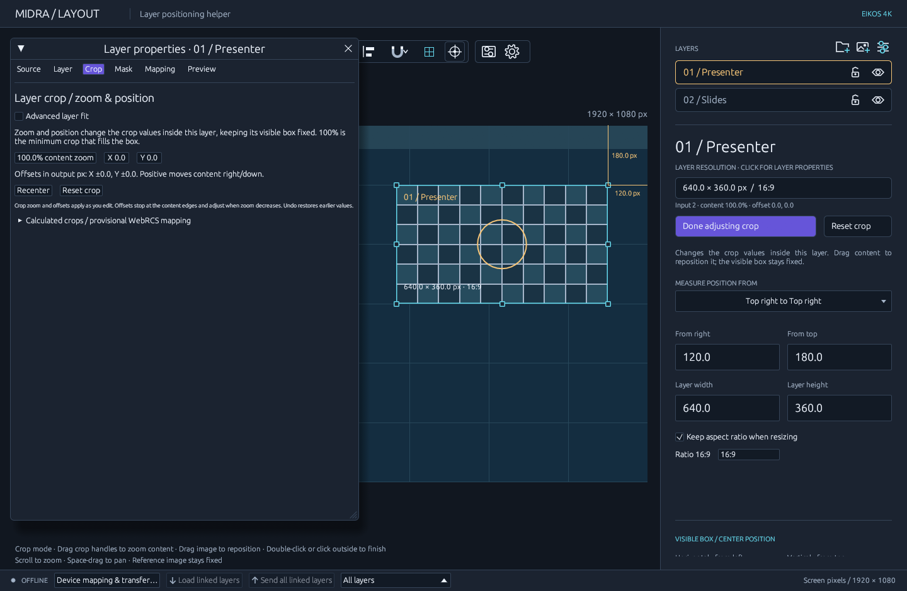
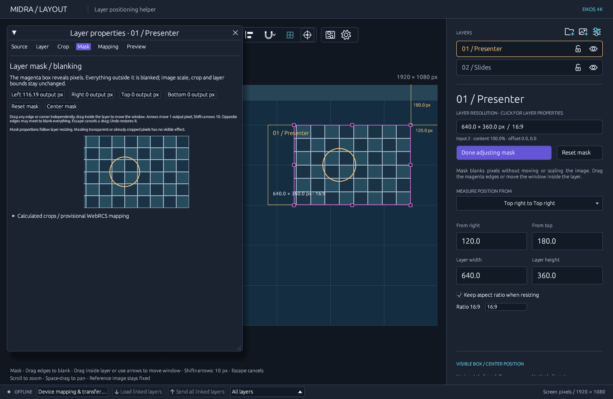

# Formats, crop and precision

[Canvas Pilot](../introduction.md) · [Guide contents](overview.md) · [Starter files](../../templates/canvas-pilot/catalog.md)

Choosing an exchange format? See the [file and clipboard feature matrix](format-matrix.md)
for naming, crop, pictures and editable-settings support.

## Formats and content framing

Open the **Output format** icon (screen with sliders), first in the toolbar, for HD (1280 × 720), Full HD (1920 × 1080), UHD 4K
(3840 × 2160), aspect presets or a custom whole-pixel resolution. Output/native
sizes support 1–16384 pixels per side as an implementation limit, not a promise
of hardware support. Layer positions/sizes remain unchanged; screen-corner
coordinates, alignment, reference-image mapping and warnings use the new output.
Valid output presets and numeric resolution edits apply immediately; invalid drafts
leave the output unchanged and are retained for correction.
The same window offers numeric camera zoom relative to fit-to-screen and a
**1:1 display pixels** action; camera changes never modify crop geometry.

Select one layer and click its **Layer resolution** card to open **Layer properties**:

1. Use **Source → Open shared input settings…** for physical input preprocessing.
   Review and send input changes separately, then reload affected layers. The
   former local Editor input/pre-crop controls have been removed.
2. Set **Layer resolution** to the final visible box. Use the aspect toggle to
   enter an independent custom width and height. Layer changes apply immediately;
   the selected measurement anchor stays fixed. Device input changes require their own review and send.
3. Use **Layer crop / zoom & position** for zoom (100–10000%) and X/Y offsets in output pixels.
   Zoom is bounded to 100–10000%; negative or non-finite entries are rejected.
   X/Y offsets remain signed for left/up positioning; they are not crop amounts.
   These controls operate on the applied formats and update immediately as edited.
   A continuous zoom/offset drag is one Undo step;
   **Recenter** preserves zoom; **Reset crop** returns to the minimum centered
   cover crop. Invalid typed offsets show the permitted range and do not apply.
4. Click **Adjust layer crop** in the selected layer’s parameters, below its format
   summary, or **double-click a layer on the canvas**, to drag or arrow-nudge
   content inside the fixed box. The button
   highlights while active; press **Enter**, double-click again or click **Done adjusting crop** to leave the mode.
   Drags clamp at valid crop boundaries; Escape cancels a drag and leaves this
   mode. Wheel zoom still controls the camera. A source-coordinate test pattern
   illustrates framing; it is deliberately separate from the screen reference.
   While editing, cropped-out content appears at 50% opacity outside the box,
   behind other layers. This preview stops at the usable input boundary; input
   cropping remains excluded. The content inside the box stays fully opaque.
   Grab the faded area to reframe content too; other visible layers covering it
   take precedence. Empty space beyond the usable input is not draggable content.

Layers keep independent crops and masks. Physical input preprocessing is shared
by every layer consuming that signal, including layers outside this project.

Moving/alignment preserves crops. Resizing keeps content zoom and the retained
center where possible, automatically shifting the crop when needed to fit the
new size. Reloading from the device refreshes processed source dimensions.
No recentering or extra acceptance is needed. Undo restores both size and crop.
**Layer properties → Crop** activates visual crop editing while the tab is open.
Switching to Source/Layer or closing the window turns it off; no extra button is needed.
The standalone inspector and context-menu crop controls remain available.

**Adjust layer crop** changes the crop values inside the layer while keeping its
visible box fixed; **Reset crop** returns to the minimum centered crop.

**Calculated crops / provisional WebRCS mapping** shows layer crops in processed-source
pixels, retained bounds,
visible size/center, and projected full-input geometry. These values are not a
verified device recipe: Centered-mode container behavior, crop units/limits and
quantization still require offline firmware verification. No hardware commands
are generated or sent. See [the resolution model](../resolutions.md)
for equations and worked examples.

<!-- Screenshot recipe: ../images/capture.md#advanced-guide-captures -->

*The cyan helper frames the content while the visible layer box stays fixed. The header still uses the former Midra Layout name.*

## Crop ratio presets for embedded black borders

In **Layer properties → Crop**, use the **Crop borders to ratio** box: **4:3**,
**16:9** or **16:10**. These presets trim symmetric borders baked into a signal,
such as a 4:3 PowerPoint slide sent inside a 16:9 video resolution. They shrink
the visible layer around its center to the requested ratio and crop its picture
at the same time, rather than stretching the slide. The largest rectangle of
the chosen ratio that fits inside the uncropped layer bounds is retained. Each
click restores those bounds first, so switching ratios replaces the previous crop.

For example, 4:3 on a full 1920×1080 layer removes 240 pixels from each side and
leaves 1440×1080. Conversely, 16:9 on an 800×600 layer removes 75 pixels from the
top and bottom and leaves 800×450. Repeated clicks on the same ratio do not progressively crop the picture.

Right-click selected layers in the viewport or layer list and choose **Crop
presets** to apply the same correction to several layers in one Undo step.
Enable **Crop within existing crop** to keep the old behavior and trim the
current crop further. This session-only toggle is off by default and is shared
between the properties and context menus. Presets do not detect black pixels.
Use manual crop controls for asymmetric borders. Explicit layer-fit modes are retained
and fit the cropped picture into the new box. Shared input settings, source routing
and masks are unchanged. No device command is sent. Finish pending numeric or
property edits before applying a preset.

## Display/export precision and midpoint handles

Geometry in the viewport, inspector and calculation view is shown to the nearest
0.1 pixel. Copied positions and provisional calculation exports use whole pixels
(round-half-away-from-zero). Internal geometry and crops retain full precision;
viewing/copying or applying unchanged rounded fields does not quantize the document.
This presentation rule does not validate the hardware's crop/container mapping.

Each selected box also has a handle at the middle of every side. Dragging top or
bottom resizes height with the opposite edge fixed; left or right does the same
for width. With the aspect lock enabled, the other dimension scales around its
center, keeping the opposite edge’s midpoint fixed. Disable it to change just
one axis. Corner handles still keep the
opposite corner fixed. Crop preservation, lock protection, Escape and Undo apply
to both kinds of resize handles.

Apply buttons are muted and disabled when their values already match the layout.
Pending changes make Apply solid purple. This applies to position/size, output
resolution drafts, names/folders, and mapped imports. Each
section tracks its own values; reverting an edit clears its pending state.

**Source** links to the [shared Input settings window](#shared-device-input-settings)
for native device preprocessing. These input-only edits require their own explicit
review and send; a layer-layout send never includes them.

Layer properties has six tabs: **Source** links to shared input settings,
**Layer** edits the visible box, **Crop** edits content framing, **Mask** edits
blanking, **Mapping** edits device destinations, and **Preview** controls capture,
refresh, preview visibility and guide opacity.
The right-click properties entries open their matching tab directly.
Mapping offers device screen/layer selectors when connected, or numeric IDs offline.
Link edits apply locally immediately and support Undo. **Unmap** removes the link,
excluding the layer from linked sends and loads; it does not change the device.
Layer size and
Crop changes apply immediately; normal zoom/offset drags are one Undo step.

Position/size edits commit on Enter or focus loss, output resolution changes
apply as edited, and names/folders commit on Enter or focus loss (also before
closing or changing the layer list). These controls have no Apply button.
Invalid geometry stays unchanged and errors appear inline. Closing output
settings discards invalid uncommitted values without a confirmation dialog.

Source edits remain staged; **Apply source changes** commits them. Closing with
pending Source edits, a rename, invalid batch names/folders, or mapped Midra
imports asks **Would you like to apply changes?**, with **Apply** and **Discard**.
Invalid Apply keeps the draft and error. Clipboard/SVG review uses **Import mapped
values**; Escape or clicking outside asks Apply/Discard, while Cancel discards.
Pending property/name edits temporarily disable the main workspace to preserve
the edited layer. Switching property tabs keeps pending Source edits.

Reference display, camera, theme and preference controls already apply immediately.
Device destination links also save to the local document immediately. Device
sends remain explicit: closing export configuration never sends, and local
Apply/Discard prompts never write to Midra. This does not change project save or
application-exit behavior. Applied edits recover automatically on launch; use Save project for a separate named copy.

While adjusting a layer crop, click empty canvas or another layer to leave crop
mode and select normally. Clicking or dragging the visible image or its faded
outside preview keeps crop mode active. Property controls remain usable while
editing the crop.

In visual crop mode, an accent-colored bounding box surrounds the full usable input image,
including the faded preview. Drag any corner or side midpoint to zoom the content
through cropping; the gold visible layer box stays fixed. Content always keeps
its proportions, independently of the layer resize ratio toggle. The opposite
content corner or edge stays anchored where possible; offsets clamp to keep the visible
box filled when zooming out. Zoom is limited to 100–10000%. Drag the image to pan
its content. Each zoom gesture is one undo step; Escape cancels an active gesture.
Use viewport zoom/pan to reach content handles beyond the current view.

## Advanced layer fit (Midra)

In **Layer properties → Crop**, check **Advanced layer fit** to expose explicit
**1:1**, **Centered (fit)**, **Fullscreen (stretch)** and **Cropped (fill)** modes.
The layer rectangle now describes a container. Crop edges, entered in source
pixels, apply first; the retained image is centered and clipped to that container.
1:1 preserves pixel scale, Centered preserves proportions with transparent
margins, Fullscreen stretches, and Cropped fills while clipping overflow.

Resize changes the container and preserves these crop edges. For **1:1**, double-click
the layer or choose **Adjust layer crop** to show the crop helper. Drag a side to
trim/restore that source edge; corners adjust two edges independently. The cyan
outline shows the retained image, with the usable source faded behind it. It
never zooms or stretches the image, and ignores aspect lock/pivot scaling.
The retained picture stays centered, so its outline contracts/expands symmetrically
even though only the chosen source crop edge changes. The container stays fixed.
Drag anywhere inside the layer, including empty margins outside the retained
picture, to reposition the crop as a whole. The picture follows the pointer;
opposite crop edges trade pixels, preserving the retained width/height and 1:1
scale. Movement stops at the usable source boundaries. Arrow keys move by one
source pixel; Shift+arrows move by ten. The layer container stays in place.
Use viewport zoom/pan to reach handles outside the screen. Each drag is one Undo
step; Escape cancels an active drag and exits the helper. Numeric crop fields stay
in sync. **Centered** and **Cropped** fit automatically, so their helper button
and context-menu action are disabled and double-click does not open a helper.
Their numeric crop edges remain editable in Crop properties. Fullscreen continues
to use the numeric crop controls. Unchecking
resets to normal centered cover framing. Input/global inheritance is intentionally
omitted. Pending Source edits remain staged and require Apply as usual.

Midra loads preserve all four explicit modes and open the checkbox automatically.
Sends use container dimensions regardless of sizing strategy, and never change
input routing. Aquilon sends reject advanced fit until its adapter supports it.
Projects/recovery preserve the mode. Pixel rounding is approximate pending the
[engineering precision follow-up](../midra-fit-precision.md).

## Masking without resizing

**Mask from** selects the reference:

- **Layer** (default): edges are measured from the layer boundary and stay
  proportional to the layer when resized.
- **Source**: edges are measured from the usable source picture, after device input
  preprocessing but before layer crop/zoom and fit. The magenta guide can extend outside
  the layer and follows the picture when panning or zooming. A faded source preview
  helps position it. Only the intersection with the visible layer is rendered.

Switching reference keeps the edge percentages, so it can change the visible result.
Numeric fields use output pixels for Layer and source pixels for Source. **Reset mask**
clears all edges while keeping the selected reference.

Open **Layer properties → Mask**, or right-click a selected layer and choose
**Crop & mask → Adjust layer mask**. **Crop & mask → Reset mask** clears its edges
without changing the mask reference, crop or layer dimensions, and supports Undo.
For keyboard editing, double-click a layer to enter crop
mode, then press **Tab** to switch to the mask; press **Tab** again to return to crop.
This works with normal crop and 1:1 editing using the Select tool. It avoids Alt
mouse gestures that some Wayland desktops/window managers intercept.

Tab switches only in the canvas editing mode, with no control focused or property
window open. In settings and text fields it retains normal keyboard navigation;
Shift+Tab is unchanged. Holding Tab does not repeatedly toggle, and active drags
keep their mode. No crop or mask values change just by switching.

You can also **hold Alt**
(**Option** on macOS) with the Select tool to temporarily show and edit the mask
instead. Release Alt to return to crop; mask changes are kept. No properties window
opens. If you release Alt during a drag, the mask guide stays active until that drag
ends. Alt alone does nothing outside crop mode and still zooms out with the Zoom
tool. Some Linux window managers reserve Alt + mouse gestures; use the context
menu if the desktop intercepts it.
The magenta rectangle reveals the image; outside pixels
are blanked transparently in normal viewing and output. While editing the selected
layer's crop or mask, the masked portions inside the layer instead show a 25%-opacity
source guide with sparse magenta diagonal hatching. This keeps hidden content
readable and distinguishes masking from the ordinary faded crop overflow outside
the layer. The hatching and masked-content guide disappear when editing ends;
they are never exported or sent to the device. It works with normal crop and every advanced fit.

- Drag a side or corner independently to blank more or fewer pixels.
- Drag anywhere inside the layer to move the reveal window without resizing it.
- Arrow keys move one output pixel; Shift+arrows move ten.
- Enter Left/Right/Top/Bottom distances in output pixels.
- The alignment menu aligns the mask window to the selected reference’s edges or center.
- **Center mask** preserves its size; **Reset mask** removes all blanking.
- **Enter** finishes crop/mask editing and keeps the live changes. When typing in
  a numeric field, Enter confirms that value first; press Enter again after leaving
  the field to finish. Other unapplied properties use the existing Apply/Discard
  review, so finishing cannot silently discard them.
- Undo restores a complete drag; Escape cancels the active drag.

Opposite edges can meet to blank the whole layer, and remain draggable afterwards.
Masking never modifies the crop, fit, image scale or layer bounds. Blank areas
reveal lower layers. A mask over already cropped or transparent pixels has no
visible effect. Mask proportions stay relative to the selected reference. Project files and
embedded snapshots retain masks; plain geometry exports omit them. Midra and Aquilon
load/send support the resulting blanking for either mode. Device loads return a
layer-relative mask because devices do not store the editor’s source reference.
Aquilon supports rectangular blanking with Centered framing; its explicit fit and
Cut & Fill modes are separate limitations. Sending a zero mask clears destination
blanking in the reviewed transfer.

<!-- Screenshot recipe: ../images/capture.md#advanced-guide-captures -->

*The left mask edge blanks part of the picture without resizing the gold layer box. The header still uses the former Midra Layout name.*

## Content ratio versus Transform to

The [Midra 4K v3.1 manual, §10.2.6.1, page 65](https://impact-even.com/userfiles/files/telechargement/video/analogway_pls4k_manuel.pdf#page=65)
distinguishes two input corrections:

- **Content ratio** interprets the source's intended proportions, including
  non-square pixels. Native is the normal choice. Its fixed presets are 5:4,
  4:3, 16:10, 15:9, 16:9, 21:9, 256:135 and 64:27; this selector has no Custom.
- **Transform to** sets the final ratio presented to layers. Signal Aspect Ratio
  keeps the signal ratio; alternatives include fixed ratios and Custom.
- **Layer fill option** is separate: it controls fitting when a layer inherits
  input settings. Canvas Pilot uses explicit layer fitting instead.

These are input-level corrections shared by every layer using the input, not
layer cropping or masking. They can correct stretched content, but an arbitrary
ratio can also introduce distortion. Leave Native / Signal Aspect Ratio unless
correction is intentional.

Canvas Pilot exposes both device selectors in **Input settings…**, with Custom
ratio displayed as 0.250–10.000:1 and encoded in thousandths.
They are staged device controls, not persistent local image deformation. Merely
opening the controls never writes. A local source resolution is a separate
quantity and should not be changed just to pretend a ratio correction occurred.

The manual establishes the purpose and scope, but does not give the exact
corrected pixel dimensions, rounding or interaction with layer 1:1. A local
preview model must distinguish sampled input pixels from corrected display
proportions and avoid applying a correction twice when loading device-reported
content dimensions. These details need evidence before claiming an exact device
round trip.

Device input drafts are session-only; [project snapshots omit them](advanced-exchange.md#saved-input-corrections). Opening a file never changes an input.

## Shared device input settings

Open **Input settings…** from the application menu, or **Open shared input
settings…** in the layer's Source tab. Choose a physical input independently of
editor layer selection. On Aquilon, **Read input settings** loads that input's
additional controls without downloading the complete device store.

This edits preprocessing shared by every consumer of that input, including
Program and layers outside the project. Nothing is sent while dragging, selecting
an input, capturing an image or opening the window. Use **Review input changes**,
then **Send input settings** to apply the edited fields and verify them.

- **Input crop:** drag edges/corners or move the retained box. Crop zoom reduces
  or expands the retained region around the selected pivot using the **− slider +**
  percentage control; it does not add a
  second zoom stage. Numeric edges use native device crop coordinates.
- **View zoom:** changes only the editor view; wheel zooms and middle drag pans.
  Reset crop, Undo input edit and Escape during a drag help recover an edit.
- **Aspect**, **Color** and **Processing** expose adapter-specific settings.
  Keying and LUT controls appear only when supported/available. Resource allocation,
  signal negotiation and HDCP remain in WebRCS.
- **Capture input:** displays the device thumbnail unchanged. Aquilon's emulator
  blanks cropped edges in this image. No raw/pre-crop endpoint is confirmed, so it
  is displayed separately from the crop grid, without applying crop a second time.

Drafts are session-only and are not included in projects or exports. Switching
inputs retains their drafts; changing connection discards them. Reload selected
input replaces its draft with device values. If another controller, signal or plug
changes, refresh and review before sending. After changing input geometry, reload
its affected layers before sending their layout.

**Current Aquilon limitation:** framing transfers still reject inputs with active
shared crop or aspect correction. The input editor can edit those settings, but
reloading does not bypass that restriction. Correct conversion of those processed
inputs remains pending; the removal of local pre-crop does not claim that support.

The old local source pre-crop model and saved input proposals have been removed.
Projects retain processed source dimensions and independent layer framing; legacy
native projects can be opened with a reported best-effort recovery.
