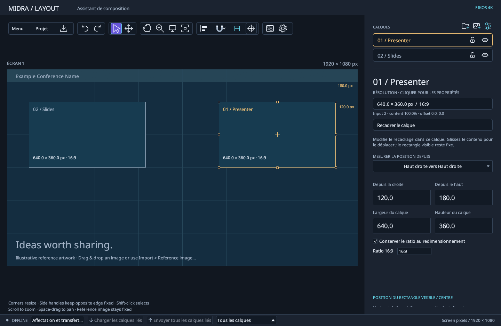
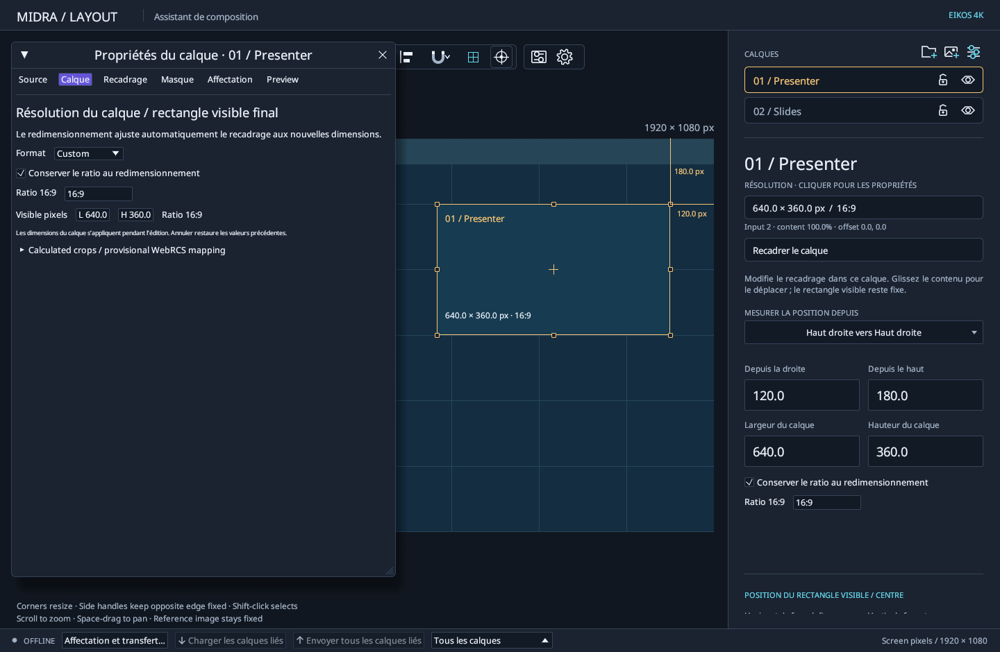
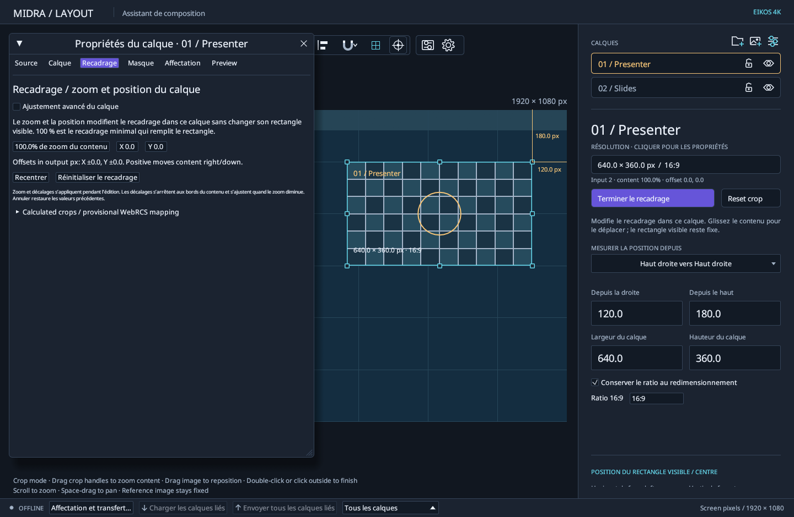

<div lang="fr">

# Démarrage rapide : votre première composition

**Français** · [English — version de référence](../quickstart.md)

> **À propos de cette version française.** Ce guide est issu d’une traduction
> automatique ; la terminologie de l’interface française a été validée. Le
> [manuel anglais](../../introduction.md) reste la référence et peut évoluer avant
> cette page. En cas de différence, consultez la version anglaise. Seul ce
> démarrage rapide est traduit pour le moment ; les autres chapitres sont en anglais.
> Les captures montrent l’interface en français. Les noms des calques, les titres
> d’exemple et les termes propres aux appareils conservent leur langue d’origine.

<!-- Translation source: docs/canvas-pilot/guide/quickstart.md at daa8975. French UI terminology accepted 2026-11-16; instructions and screenshots aligned with that UI. English remains authoritative; no independent editorial review of this adapted chapter is claimed. -->

Créez une composition simple avec les calques **Slides** (diapositives) et
**Presenter** (présentateur), enregistrez un projet modifiable, puis exportez sa
géométrie. Ce tutoriel utilise le canevas Full HD par défaut et fonctionne hors
ligne : aucun processeur vidéo n’est nécessaire.

## 1. Ouvrir une nouvelle composition

Suivez d’abord les [instructions d’installation et de mise à jour (en anglais)](../install.md),
puis lancez Canvas Pilot. Dans **Menu → Ouvrir tous les réglages…**, choisissez
**Français** dans **Language / Langue**, en haut des réglages. Le changement est
immédiat : confirmez avec **Oui** dans les 20 secondes pour le conserver au prochain
lancement. Le bouton de refus reste dans la langue précédente. Un refus, la touche
Échap ou la fin du décompte rétablit cette langue.

Si vous travaillez depuis les sources du projet, exécutez
cette commande à la racine du dépôt :

```sh
cargo run --locked -p canvas-pilot
```

Consultez la [configuration de développement (en anglais)](../../../development/README.md)
si vous avez besoin des outils de compilation. Si une composition précédente a été
restaurée, enregistrez le travail à conserver, puis choisissez
**Projet → Nouveau projet…** et confirmez.

Le canevas par défaut mesure **1920 × 1080** et contient les calques **Slides** et
**Presenter**. Conservez cette résolution pour ce tutoriel.

<!-- Screenshot recipe: ../../images/capture.md#french-quick-start-captures -->


*Interface en français ; les noms et le contenu du projet restent inchangés.*

## 2. Placer et dimensionner les calques

1. Cliquez sur **Presenter** dans la liste **Calques** ou sur le canevas.
2. Faites glisser le calque pour le déplacer. Faites glisser une poignée d’angle
   pour le redimensionner ; laissez **Conserver le ratio au redimensionnement** coché
   pour conserver ses proportions.
3. Pour un placement précis, utilisez les champs de position de l’inspecteur.
   Vérifiez d’abord le coin de référence choisi : **Depuis la droite** mesure la distance
   depuis le bord droit, et non depuis le bord gauche.
4. Sélectionnez **Slides** et placez-le à côté du présentateur. Utilisez **Annuler**
   pour annuler un déplacement ou un redimensionnement qui ne vous convient pas.

Le champ de résolution du calque ouvre **Propriétés du calque**, où vous pouvez saisir
une largeur et une hauteur exactes. Conservez les dimensions par défaut si vous
souhaitez seulement essayer le placement.



## 3. Essayer le cadrage du contenu

Avec **Presenter** sélectionné, ouvrez **Propriétés du calque → Recadrage**. La mire de la
source montre comment le contenu s’inscrit dans le rectangle visible du calque.
Faites glisser le contenu pour ajuster sa position ou utilisez les poignées de
recadrage pour modifier son zoom.

Le rectangle visible du calque reste fixe pendant le recadrage. Utilisez
**Réinitialiser le recadrage** pour retrouver le cadrage par défaut, puis revenez à l’onglet
**Calque** pour terminer. Vous pouvez ignorer cette étape si seules les positions
des rectangles vous intéressent.



## 4. Enregistrer le projet modifiable

Appliquez les modifications de propriétés en attente, puis choisissez
**Projet → Enregistrer le projet…** et enregistrez le fichier sous
`first-layout.pilot.json`. C’est ce fichier qu’il faut rouvrir pour poursuivre
l’édition : il conserve le projet, notamment les réglages des sources, le recadrage
et les images de référence.

Utilisez **Projet → Ouvrir un projet…** pour le charger ultérieurement.

## 5. Exporter la géométrie des calques

Choisissez **Projet → Exporter → Exporter les calques…**, sélectionnez **SVG** et
**Tous les calques**, puis cliquez sur **Exporter…** et enregistrez le fichier. Pour exporter
uniquement les rectangles des calques, laissez désactivées les images d’arrière-plan
et les images de substitution. Le SVG peut être ouvert dans un éditeur vectoriel.

Comparez les possibilités des fichiers et du presse-papiers dans le
[tableau des fonctionnalités par format (en anglais)](../format-matrix.md)
avant de choisir un format d’échange.

Conservez aussi le projet `.pilot.json` : un export de géométrie ne garde pas tous
les réglages de l’éditeur. Le [catalogue de modèles (en anglais)](../../../templates/canvas-pilot/catalog.md)
propose des compositions équivalentes dans chaque format pris en charge si vous
préférez commencer dans une autre application.

## Poursuivre avec le guide avancé

Vous disposez maintenant d’un projet modifiable et d’un export de géométrie.
Choisissez la prochaine étape parmi ces chapitres **en anglais** :

- [Organiser et aligner les calques](../editing.md), avec les dossiers et les sélections multiples.
- [Ajouter des images de référence et ajuster la vue du canevas](../canvas.md).
- [Régler les formats des sources et le recadrage](../formats-and-crop.md).
- [Importer une géométrie existante ou choisir les éléments à exporter](../files.md).
- [Connecter un Eikos 4K et vérifier les transferts de calques](../device.md).
  L’envoi vers un appareil est une action explicite ; l’édition locale ordinaire
  n’envoie aucune modification.

Le [guide avancé (en anglais)](../overview.md) donne aussi accès aux réglages,
aux contrats de compatibilité et aux détails des vérifications matérielles.

</div>
