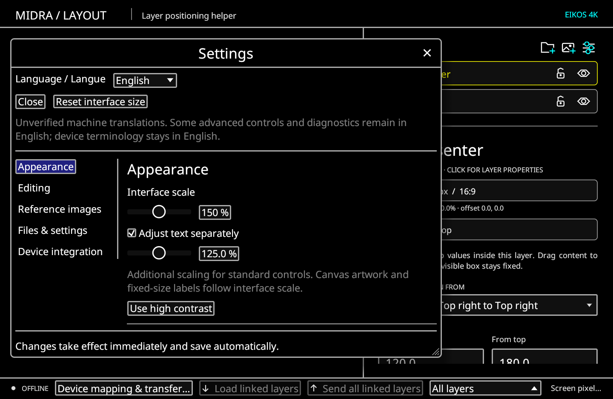
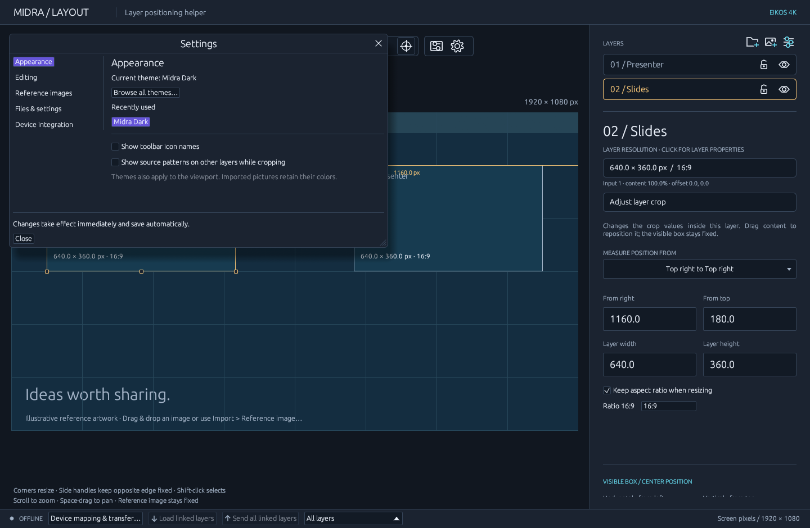

# Menus and preferences

[Canvas Pilot](../introduction.md) · [Guide contents](overview.md) · [Starter files](../../templates/canvas-pilot/catalog.md)

## Application menu

The header’s **Menu** brings the application’s commands together:

- **Open all settings…**: the full preferences window.
- **Project**: new/open/save projects and restore parameters from exports.
- **Export**: device mapping/transfers and the file export window.
- **Import**: SVG, clipboard layer values, and reference images.
- **Edit**: undo/redo, copy values, select all editable layers, or deselect.
- **View**: fit screen/selection, 1:1 pixels, output format, and reference settings.
- **Layers**: selected-layer properties, crop/reset, alignment, shared resizing,
  lock/hide, and per-layer selection/visibility/lock controls.
- **Options**: quick controls for snapping, backdrop, theme, outlines, toolbar
  captions, resize aspect ratio and the source-coordinate preview. The full
  settings shortcut stays at the top of Menu, rather than repeating here.

The toolbar, cog and right-click shortcuts use the same commands and preferences.
The standalone cog also provides **Open all settings…** above its quick controls.
Project no longer repeats Export or device transfers. Selected-layer actions in
Menu contain layer editing only; workspace controls remain under View and Options.
The canvas right-click menu keeps its Canvas group for access beside the pointer.
Detailed numeric controls remain in their existing properties dialogs.

Enable **Options → Show toolbar icon names** (also available from the toolbar cog)
to display captions beneath the icons. It is off by default and saved with the
project; older projects open with captions off.

### Interface language

Open **Menu → Open all settings…** and use **Language / Langue** at the top.
Each language shows its native name followed by its name in the current interface
language, for example **English — Anglais** in French.
Choose **System default**, **English**, **Français**, **日本語**, **简体中文**,
**Español**, **Português (Portugal)**, **नेपाली** (Nepali), **ไทย** (Thai),
**हिन्दी** (Hindi), **toki pona**, **Ἑλληνικὴ ἀρχαία** (Ancient Greek), or **Esperanto**. The change takes effect
immediately as a preview. Choose **Yes** within 20 seconds to save it for future
launches. The cancellation button uses your previous language; clicking it, pressing
Escape or letting the countdown expire restores that language. Closing the app
without confirming also leaves the previous saved choice intact. In French, the route is
**Menu → Ouvrir tous les réglages…**; language names stay recognizable in either UI.

System default follows supported system languages, with English fallback. Chinese
uses Simplified Chinese; Traditional Chinese system locales fall back to English.
Portuguese uses European Portuguese; Brazilian system locales fall back to English.
Toki Pona uses Latin spelling. English is the official reference language.
French interface terminology has been accepted; the other translations remain
unverified machine translations. Some explanatory text, advanced controls and
technical diagnostics remain in English, as do device control names. Built-in open
fonts cover Japanese, Chinese, Devanagari, Thai, Latin text and polytonic Greek without installing
fonts separately. **Files & settings → Font licenses** contains their license.

Nepali and Hindi conjuncts and vowel placement, and Thai stacked marks, use native
text shaping. These remain preview languages: Thai wrapping has no guaranteed
dictionary-based word boundaries, and the End key can place the caret past the
text for Thai characters such as `ำ` that expand into several glyphs. For those
names, avoid relying on End followed by Backspace; select the whole field to
replace it. This limitation concerns text editing, not interface labels.

Use **Settings → Language packs** to install/update ZIP packs, view their revisions
and languages, or remove them. Newer revisions update immediately; equal or older
revisions ask before overwriting. Removal asks for confirmation.
See [Add a language pack](language-packs.md) for the Ukrainian/Bhojpuri example and
instructions for writing a translation. Installed languages appear below the built-in
choices and use the same confirmation.

The book's [French quick start](fr/quickstart.md) now follows the accepted French
interface wording and uses French screenshots. It records its machine-translation
origin and links to the English manual as the authoritative source.

Changing language preserves the open project, pending edits and device connections.
It does not rename layers, change file contents or send device commands. Numeric
fields continue to use a decimal point in every language. Projects do not carry
language preferences to another workstation.

### Interface size and high contrast

Open **Menu → Open all settings… → Appearance**:

- **Interface scale:** resize the entire interface from **50% to 400%**, on top
  of the operating system's display scale. This also scales icons and hit targets.
- **Adjust text separately:** optionally scale standard control text by an additional
  **50% to 200%**. Canvas artwork and fixed-size labels follow interface scale only.
- **Use high contrast:** select a black-based theme with white text, bright accents
  and stronger control borders. It also appears as **High Contrast** in the theme browser.

Scale values update while dragging, but resizing applies only after releasing
the pointer. Typed values apply after finishing text entry. Preferences are
remembered on this computer. **Reset interface
size**, near the top of Settings, restores 100% and disables separate text scaling.
Smaller scales free up space on low-resolution displays; larger scales support
high-resolution monitors. These ranges do not depend on monitor resolution.
The settings content scrolls at smaller window sizes. Larger windows provide more
working space at high zoom. Project dimensions, exported artwork, clipboard data
and device values stay unchanged; imported pictures retain their original colors.

*Enlarged controls with High Contrast. Close and Reset interface size remain above the scrolling settings.*

### Application themes

**Menu → Options → Theme** (also in the toolbar cog) shows up to three recently
used themes, newest first. **More themes…** opens the complete picker with color
swatches: Midra Dark plus all 18 themes from the SOTV song-database theme folder.
A fresh installation lists only Midra Dark until other themes are selected.
Selecting a theme updates the UI and viewport immediately and saves the recent
history across restarts. Reusing a theme moves it to the top without duplicates.
Closing the picker without choosing leaves the theme and history unchanged.

The viewport, grid, layer boxes and source test patterns use the selected palette;
selected layers remain gold (darker gold for contrast in light themes). Imported
reference images retain their colors. Theme and history survive opening projects
and are not included in project JSON or geometry exports.

The SOTV palettes are bundled with the app from
`sotv/song_database/styles/themes/` in the sibling `SOTV_Websites` repository;
Corporate Light uses `styles/base/variables.css`. No sibling repository is needed
to build or run Canvas Pilot. See the [theme catalog and settings contract](../../interfaces/canvas-pilot-settings.md)
for names, source files, stable IDs and palette adaptations.

### Saved application options

Options save automatically when changed: theme, toolbar icon names, aspect-ratio
lock and source-coordinate preview. No separate Apply or Save is needed.
The `directories` crate selects the OS configuration directory. Canvas Pilot retains
the former Midra Layout location so existing preferences and recovery remain available:

- Linux: `$XDG_CONFIG_HOME/midra-layout/settings.json`, or
  `~/.config/midra-layout/settings.json` when XDG_CONFIG_HOME is unset.
- Windows: `%APPDATA%\beffroi\midra-layout\config\settings.json`.
- macOS: `~/Library/Application Support/org.beffroi.midra-layout/settings.json`.

Hover **Options save automatically** in Options to see the actual path. These are
startup defaults. Existing project files still restore their saved aspect-ratio,
caption and source-preview settings for the open document, without rewriting the
application defaults. A subsequent explicit Options change saves the current set
of options as the new defaults. Theme always remains an application preference.

Missing settings use defaults; the file is created on the first option change.
Unreadable, malformed or unsupported settings use defaults and show an Options
error; the original file is preserved and saving is disabled until the file is
repaired or moved and the application restarted. Write failures keep options
active in memory and offer **Retry saving options**. No project data, images or
clipboard contents are stored here. The [settings interface](../../interfaces/canvas-pilot-settings.md)
documents the file and compatibility rules.

**Keep aspect ratio when resizing** is also available below the position/size
fields in the selected layer's right panel and in the layer
right-click menu (including multiple selections). These controls share the
Options setting and save changes automatically. They do not apply or discard
pending size/position edits. Crop zoom remains proportional.

<!-- Screenshot recipe: ../images/capture.md#advanced-guide-captures -->

*Settings are grouped by purpose; appearance changes apply immediately. The header still uses the former Midra Layout name.*

## Settings window

Open **Menu → Open all settings…**, **Options → Open all settings…**, the toolbar cog's
**Open all settings…** entry, or **Ctrl/Cmd+,**. The window groups the available controls:

- **Appearance:** themes, recent choices, icon captions and source-coordinate preview.
- **Editing:** aspect-ratio lock, movement snapping and a keyboard/mouse reference.
- **Reference images:** import and access to the current project's image settings.
- **Files & settings:** the settings-file path, copy-path action and restore defaults.
- **Midra integration:** current offline status and compatibility limitations.

Changes apply and save immediately, sharing state with quick menus and inspector
shortcuts. Close simply dismisses the window. Restore defaults resets preferences
without altering geometry or pending position/size edits. Device controls are not
presented as implemented until their mapping and transport are available.

### Movement snapping

The viewport right-click menu and quick Options menu both include **Snapping**:
enable movement/resizing snapping and choose pixel, screen or visible-layer edges.
These are the same automatically saved controls as Settings → Editing.

Enable **Settings → Editing → Snap movement & resizing** and choose pixel,
screen-edge and/or other-visible-layer-edge targets. Nearby edges show a guide;
the proximity radius stays six logical pixels at any zoom. A selection moves as
a rigid group. Hidden layers are ignored; visible locked layers can be targets.
Hold **Alt** to temporarily invert snapping: off when enabled, on when disabled. Turning snapping on/off alone never moves layers.
Exact numeric entry and nudges bypass proximity snapping; resize handles snap while preserving their anchors/ratios, and crop-content
handles retain their existing behavior. One drag remains one undo step, with Escape to cancel.
