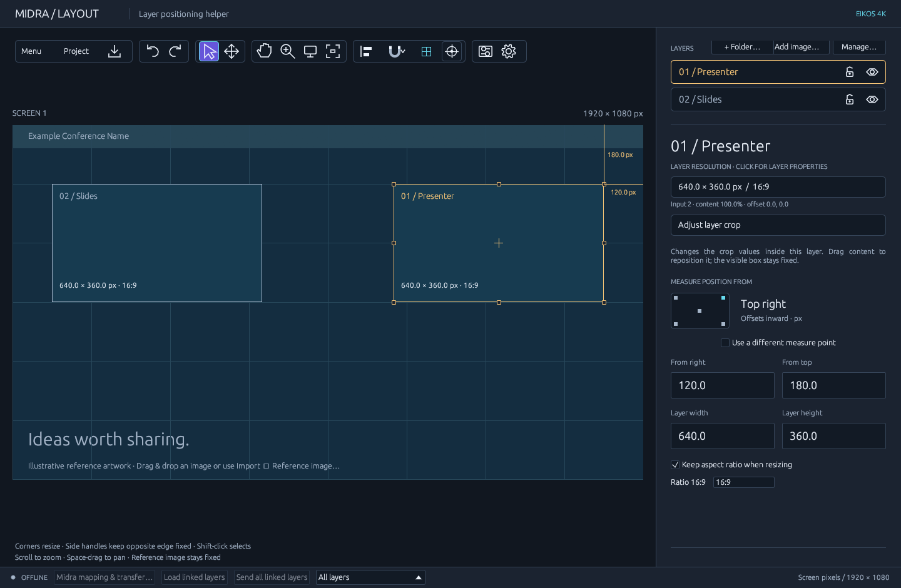

# Quick start: your first layout

[Introduction](../README.md) · [Advanced guide](README.md) · [Starter files](../../templates/canvas-pilot/README.md)

Make a simple Slides + Presenter layout, save an editable project, and export its
geometry. This walkthrough uses the default Full HD canvas and works offline;
no screen processor is needed.

## 1. Open a fresh layout

First follow [Install and update](install.md) to get Canvas Pilot, then launch it.
If working from a development checkout, run this command from the repository root:

```sh
cargo run --locked -p canvas-pilot
```

See [development setup](../../development/README.md) if you need the build tools.
If a previous layout was restored, save any work you want to keep, then choose
**Project → New project…** and confirm.

The default canvas is **1920 × 1080**, with **Slides** and **Presenter** layers.
Leave that resolution unchanged for this walkthrough.

<!-- Screenshot recipe: ../images/README.md#01-workspacepng -->


## 2. Place and size the layers

1. Click **Presenter** in the Layers list or on the canvas.
2. Drag the layer to position it. Drag a corner handle to resize it; keep
   **Keep aspect ratio when resizing** checked to preserve its proportions.
3. For exact placement, use the inspector's position fields. Check the selected
   measurement corner first: “From right” measures from the right edge, not the left.
4. Select **Slides** and position it beside the presenter. Use **Undo** if a move
   or resize is not what you wanted.

The layer-resolution field opens **Layer properties**, where you can enter exact
width and height. Leave the default sizes if you only want to try positioning.

## 3. Try framing the content

With **Presenter** selected, open **Layer properties → Crop**. The source pattern
shows how content fits inside the visible layer box. Drag the content to adjust
its position or use the crop handles to change its zoom.

The visible layer box stays fixed while cropping. Use **Reset crop** to return to
the default framing, then switch back to the **Layer** tab to finish crop editing.
You can skip this step if you only need rectangle positions.

## 4. Save the editable project

Apply any pending property edits, then choose **Project → Save project…** and
save as `first-layout.midra.json`. This is the file to reopen when you want to continue
editing: it retains the project, including source/crop settings and reference images.

Use **Project → Open project…** to load it later.

## 5. Export the layer geometry

Choose **Project → Export → Export layers…**, select **SVG** and **All layers…**,
and save the export. For plain layer boxes, leave the background and placeholder
pictures disabled. The SVG can be opened in a vector editor.

Keep the `.midra.json` project as well: a geometry export does not retain all editor
settings. The [starter-file catalog](../../templates/canvas-pilot/README.md) has
matching layouts in every supported format if you prefer to start in another app.

## Continue with the advanced guide

You now have an editable project and a geometry export. Choose your next task:

- [Organize and align layers](editing.md), including folders and multiple selections.
- [Add reference images and adjust the canvas view](canvas.md).
- [Control source formats and cropping](formats-and-crop.md).
- [Import existing geometry or choose export scopes](files.md).
- [Connect an Eikos 4K and review layer transfers](device.md). Device sends are
  explicit actions; ordinary local editing does not send changes.

The [advanced guide](README.md) also links to settings, compatibility contracts
and hardware-verification details.
