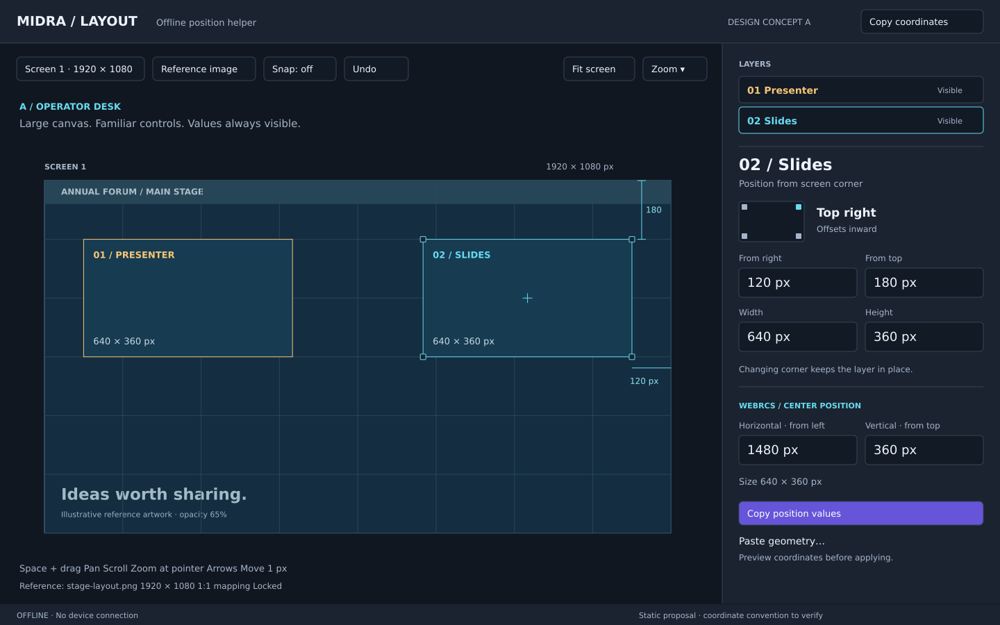
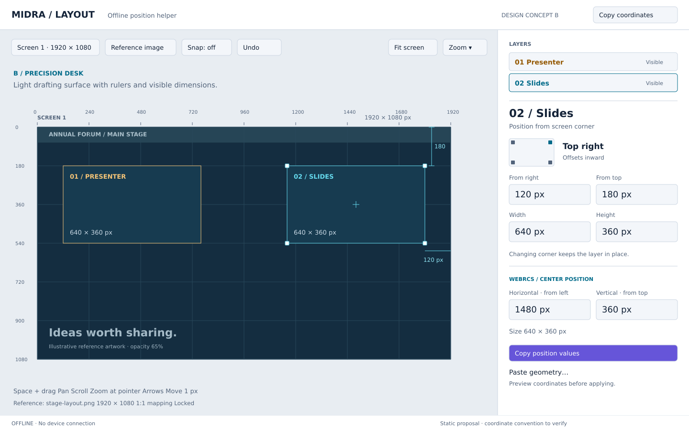
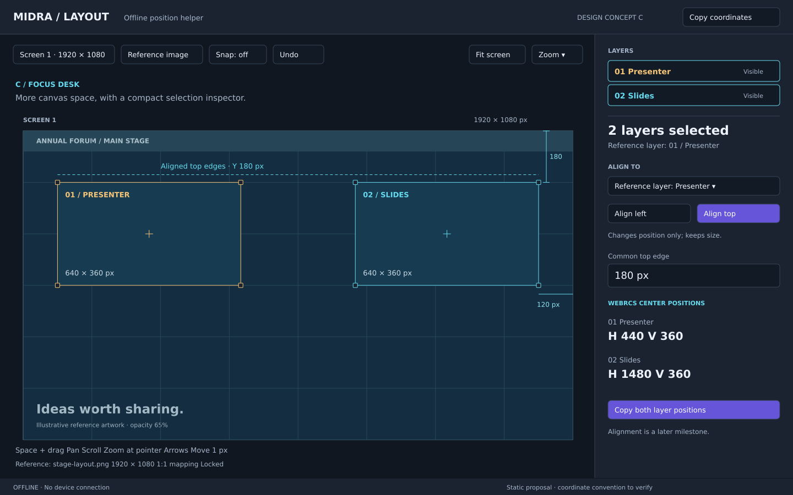

# Canvas Pilot: implementation status and backlog

Reconciled on 2026-11-14 against the current editor, device adapter, regression
tests and recorded Eikos 4K firmware 3.3.10 hardware checks. This replaces the
original draft checklist: unchecked items below are actual remaining work,
not already implemented features awaiting a historical milestone.

The original visual proposals are retained below for design context.
The [user guide](guide/overview.md) describes current controls; the
[device-send contract](../interfaces/midra-device-send.md) and
[hardware findings](device-check.md) distinguish automated tests,
device readback and physical-screen acceptance.

## Completed implementation

- [x] Rust/egui workspace app; canonical pixel geometry, stable layer/input IDs,
  source/input/layer formats, custom output resolutions, corner/center conversion
  and full-precision geometry with one-decimal display/whole-pixel export.
- [x] Multi-layer viewport, selection/marquee, movement/nudging, pointer-centered
  zoom/pan, fit controls, eight resize handles, aspect lock, pivots, proportional
  group resizing (same, horizontal mirror, opposite), alignment and undo/redo.
- [x] Snapping during movement and resize, pixel grids/rulers, screen-center and
  quarter guides, other-layer edges and temporary modifier overrides.
- [x] Advanced input/layer cropping, content zoom/offset, visual crop handles,
  reset, double-click entry and translucent retained-content surroundings.
- [x] Layer add/remove/rename/order, lock/visibility, collapsible single-level
  folders, folder selection/rename/reorder and drag organization. Folder eye/lock
  currently edits member flags in bulk; it is not inherited state.
- [x] Multiple fixed reference images, drag/drop/picker, per-image visibility,
  opacity, native-size/offset, proportional fit/stretch warnings, outline-only
  layer display and adaptive image filtering.
- [x] Reference imports and project/recovery reads, parsing, validation and
  embedded-image decoding run off the UI thread. Loading is atomic; failures
  preserve the editor. Manual project loading is cancellable and recovery
  autosave pauses while loading.
- [x] Explicit Midra input snapshot capture: available-input picker, still
  preview, Use for selected layer, preview visibility and guide-opacity controls,
  plus Add as reference. Optional timed refresh (default 10 seconds), one request
  at a time and at least five seconds between requests; visible previews only.
- [x] Clipboard/import mapping review with per-row target/ignore, independent
  size/position/available-zoom toggles, draw.io stroke handling and own-copy
  round trips. Real draw.io clipboard sample and draw.io-exported SVG supported.
- [x] Eleven-format file exchange: SVG, draw.io, geometry JSON, CSV, DXF/DWG, HTML,
  PPTX, FIG, FIGCRAFT and AI through VectorCraft. Shared geometry, scope and review,
  optional artwork where supported, page/frame selection and licensing build flag.
  Two-layer Full HD and UHD templates exist for all eleven formats.
- [x] Project JSON v15, tested legacy/recovery migration, saved layer links,
  central application preferences, full Settings, themes and recent-theme list.
- [x] Separate Midra connection and mapping/transfer controls, saved address,
  optional startup connection, online status, explicit direct linked send/load
  and configurable mapping review. Scope defaults to All with Selected/Folder.
  Unmapped rows skip; duplicate destinations within a send scope are rejected.
- [x] Persistent per-layer screen/layer links, Mapping properties and Unmap.
  Reordering/visibility do not alter links; alternative folders can reuse targets.
- [x] Multiple editor layers may share one Midra destination. Mapping warns with
  other linked layer names/folders; sends reject overlaps only within the chosen
  scope. This replaces the earlier extra-links-per-layer proposal. Nested folders
  and additional file codecs have been removed from scope following scope review.
- [x] Both device sizing strategies, Centered-crop imports, required preset apply
  pulse, rounding/reconstruction checks and readback. Preview/Program protocol
  checks on Eikos 3.3.10 are recorded; Program availability is a user preference.
- [x] Advanced shared-input settings are explicitly opt-in; only edited fields
  are sent while enabled. This supersedes the original “never write input settings”
  scope. Routing, TAKE and live playback control are not implicit geometry actions.
- [x] Geometry/import/UI/mock-device regression tests, workspace CI, coverage,
  documentation and release build configuration integration.
- [x] **Export/workflow cleanup.** Shared transfer scopes, mapping review and
  direct linked send/load are implemented. Manually reviewed and marked solved on 2026-11-15.

- [x] **Aquilon / LivePremier: first-class supported (standalone AQL Cmax 6.2.x).** Device-neutral snapshots, family-aware v13 links, bounded targeted AWJ reads, geometry/crop import, mapped Preview/Program sends and pooled input previews. See [adapter contract](../interfaces/device-adapters.md) and [emulator acceptance](aquilon-compatibility.md). Linked units, other models/firmware, shared input corrections and non-centered/masked import remain explicitly unsupported.

## To-do list

- [ ] **Localization: book first, application second.** Follow the
  [localization roadmap](../development/localization.md) for language selection,
  translation workflow, publishing, UI catalogs and compatibility checks. Detailed
  tasks and acceptance criteria live there; no translations are shipped yet.

- [ ] **Resolve local input-ratio correction scope.** Shared-input Content ratio
  and Transform to controls already exist and are [documented](guide/formats-and-crop.md#content-ratio-versus-transform-to).
  Whether to add a local correction/preview model remains an unanswered question;
  do not treat a new implementation or persistence change as decided.

- [x] **Explicit Midra layer aspect modes.** 1:1, Centered, Fullscreen and
  Cropped are available behind **Layer properties → Crop → Advanced layer fit**.
  Crop-first math, centered placement, clipping, import/send, preview and project
  persistence are implemented. Normal zoom/crop remains the default. Automated
  coverage includes both banks; physical raster precision remains a stretch goal.
- [x] **Midra layer masking.** Independent magenta reveal box, edge/corner handles,
  whole-window movement, arrows, numeric pixels, center/reset, Undo/Escape,
  project persistence and device import/send. Physical mask edge rasterization
  remains in the [engineering follow-up](midra-fit-precision.md).

### Stretch goals (distant future)

- [ ] **Video showcase, manual and optional chapter demonstrations.** Record a
  short showcase for the README and book introduction, then a guided video manual
  linked from quick start with chapter timestamps. Use the existing
  [feature demonstration checklist](feature-demo-checklist.md) as the recording
  outline. Add short chapter clips where motion helps: crop controls, 1:1 crop
  movement, masks and device mapping/transfers; start with the two main videos.
  Keep written instructions as the searchable reference. Include captions and the
  recorded application version, avoid autoplay, and host large video files outside
  Git. Link or embed them in the book once a host is chosen. This approach is
  approved; recording, hosting choice and implementation remain future work.

- [ ] **Confirm Midra fit precision with a manufacturer/firmware engineer.**
  Obtain crop quantization, subpixel centering and rasterization rules, plus
  expected results for asymmetric crops and odd container dimensions. Use the
  [engineer-ready questions and examples](midra-fit-precision.md). Operator
  pixel measurements are not a prerequisite; current implementation uses
  continuous crop-first geometry and nearest-integer device fields.

- [ ] **Consider additional presentation-switcher adapters.** Use the
  [adapter candidate survey](presentation-switcher-adapters.md) to select useful
  families by geometry/readback coverage and demand. Programming documentation
  and an API-capable emulator are required before development; physical hardware
  supports output validation. Investigate Analog Way Alta 4K first, then selected
  non-AW candidates; the list is a research backlog, not a commitment to support
  every product.

- [ ] **Multiple editor screens in one project.** Use a dropdown to select the
  active screen, displaying and editing one screen at a time. Preserve each
  screen's layout when switching; simultaneous multi-screen editing is outside
  this goal. Plan persistence and migration details when implementation is scoped.

## Test list

### Completed acceptance

Manually reviewed on 2026-11-14; these format issues are solved:

- [x] **PPTX** — working flawlessly.
- [x] **draw.io** — working.
- [x] **SVG** — working.

Import/export manually reviewed on 2026-11-15; these format issues are solved:

- [x] **Figma FIG** — import/export validated.
- [x] **FigCraft FIGCRAFT** — import/export validated.
- [x] **DXF** — import/export validated.
- [x] **DWG** — import/export validated.

Clipboard workflows manually reviewed on 2026-11-15:

- [x] **Illustrator, draw.io and Figma** — actual copy/paste working; supplied
  samples also have regression coverage.

QCAD and PowerPoint remain file-exchange workflows, with no clipboard-export
integration planned for this scope.

### Remaining tests

- [ ] **Midra layer aspect acceptance.** Follow the narrowed
  [operator test checklist](midra-aspect-test-checklist.md): explicit modes,
  mismatched source/container ratios, smaller/larger 1:1 sources, asymmetric
  layer crop and broad visual placement/clipping. Compare Preview/Program and
  record reported content dimensions if available. Exact pixel measurements are
  deferred to the engineering stretch goal. Input inheritance
  and input-correction combinations are no longer test prerequisites.

- [ ] **Inkscape clipboard acceptance.** Obtain a sample and validate actual
  copy/paste before claiming support.

- [ ] Compare known test images on the physical output for both sizing strategies,
  asymmetric/extreme crops and source aspects. Device readback is not visual proof.
- [ ] Broader firmware/source-format coverage, including exhaustive device limits,
  all corner/center placements and non-Centered/masked configurations.
- [ ] Operator-laptop checks: dense reference at Fit/100%/400%/1600%, large-project
  loading, GPU memory and measured drag responsiveness; aim for a 60 Hz interaction
  budget. Worker decoding does not remove GPU texture upload cost.
- [ ] Windows/macOS/Wayland clipboard, DPI/GPU presentation and native-dialog checks.
  Headless Linux interaction tests do not replace platform acceptance.
- [ ] Accessibility/tab order, enlarged text, contrast and narrow-window review;
  verify complete setup → position → crop → paste → copy → undo → send/load workflows.
- [ ] Exercise portable release bundles on target machines and complete the release
  checklist. Build/CI integration already exists; this is packaging acceptance.

### Verification notes

Input capture was tested with the connected Eikos on 2026-11-14: a read-only GET
returned a 512 × 288 PNG from active input 3; inactive input 1 returned a blank
128 × 128 PNG. See [snapshot contract](../interfaces/midra-input-preview.md).
No input routing, snapshot settings, still-library slot or layer was modified.
Snapshot dimensions/freshness are device-controlled and broader firmware behavior
remains unverified.

The remaining validation entries above deliberately stay open. Implemented code,
passing regression tests and protocol readback do not substitute for operator
acceptance or physical-screen inspection.

## Coordinate model and historical visual proposals

Implemented internal model: screen origin at its top-left, X increases rightward,
Y increases downward, and a layer's final visible box is `(x, y, width, height)`. Positive corner
offsets point inward. Matching corners are the default; the current editor also supports independent
screen/layer measurement points and center anchors.

For screen size `W × H`, layer size `w × h`, and offsets `dx, dy`:

| Selected corner | Layer left `x` | Layer top `y` |
| --- | --- | --- |
| Top left | `dx` | `dy` |
| Top right | `W - dx - w` | `dy` |
| Bottom left | `dx` | `H - dy - h` |
| Bottom right | `W - dx - w` | `H - dy - h` |

For uncropped geometry, the visible-box center values are
`horizontal = x + w/2`, `vertical = y + h/2`. The inverse subtracts the half-size.
The corresponding inward margins are `left=x`, `top=y`, `right=W-x-w` and
`bottom=H-y-h`. Switching corner just chooses which margins to display.

Example used in every mockup: on a **1920 × 1080** screen, a **640 × 360** layer
**120 px from the right** and **180 px from the top** has top-left **1160, 180**
and center **1480, 360**. The other layer is at **120, 180**, center **440, 360**.
An odd width such as 641 produces a half-pixel center when the left edge is an
integer; the device exporter quantizes geometry and verifies reconstruction error.
See the device-send interface for container corrections. Advanced cropping must retain these visible-box
coordinates while deriving any distinct device container through its adapter.

## Visual proposals

These are original, editable SVG interface mockups, not application screenshots.
Open them in a browser or image viewer to inspect at full size. The example
background is illustrative artwork standing in for an imported picture. Labels
such as “Copy” and “Paste” illustrate planned controls; nothing is interactive yet.

### A. Operator desk — recommended

Dark slate surfaces, cyan selection, amber second-layer identity and a restrained
purple primary action consistent with existing repository interfaces. A large
viewport occupies the left; the fixed right inspector groups the layer list,
corner selector, offsets, size and WebRCS outputs in reading order. Thin outlines,
corner markers, center crosshairs and dimension guides make selection unambiguous.

Best for working beside show-control tools. The tradeoff is less contrast against
dark reference images; add a contrasting outline halo and an outline-only mode.
Keep the output card visible while upper inspector sections scroll. A compact
bottom status line carries camera/pixel information and shortcut hints.

### B. Precision desk

A light inspector and drafting surface with screen-coordinate rulers. The same
placement workflow emphasizes measurements and field readability. The artwork
retains its own colors independently of the UI theme.

Best for daytime preparation and detailed artwork matching. It uses more visible
measurement marks and can feel busier; rulers and guides should be optional. Its
useful features can be incorporated into A without maintaining two different apps.

### C. Focus desk

A wider viewport and narrower contextual inspector. This proposal illustrates the
multi-selection state: a named reference layer, explicit alignment actions
and a compact per-layer coordinate table. The layer list remains on the right.

Best for repeated placement and comparison once the basic workflow is familiar.
Less space for numeric explanations makes it weaker as the initial default.
The alignment state is now available under step 7; the SVG remains a design concept.

### Shared interaction and responsive behavior

Keep the screen aspect ratio exact, surround it with a neutral pan area, and use
consistent screen-space selection markers. Display only relevant guides, with
labels in screen pixels. Layer identity and selected state must be distinct.
Always allow selecting a layer from the list when its outline is hard to hit.

The desktop window should retain a right inspector at normal working sizes.
At narrow widths, reduce decorative padding and collapse secondary sections;
below the proven minimum width, use a right drawer rather than crushing numeric
fields. At short heights, scroll sections while retaining access to conversion
outputs. Mouse and keyboard interaction are the first priority; a mobile UI is
not part of this desktop tool.

## Research and open decisions

The [Analog Way Midra 4K V3.2 manual, July 2024, pp. 83–85](https://www.bhphotovideo.com/lit_files/1168243.pdf#page=83)
documents layer alignment, snapping, position and size controls. This supports
the workflow research; it does not establish the precise coordinate convention
or current firmware behavior for the target installation. Avoid portraying all
WebRCS versions as lacking alignment. The proposed improvement is more explicit
corner-based positioning and reference-image inspection.

[Figma's zoom/view documentation](https://help.figma.com/hc/en-us/articles/360041065034-Adjust-your-zoom-and-view-options)
provides useful precedents for fit-to-view, selection zoom and pixel inspection.
Borrow those interaction ideas, without introducing vector-editor features.

Analog Way's [Midra 4K FAQ](https://www.analogway.com/midra-4k-faqs) identifies an
offline simulator that may help verify behavior without connecting this helper
to hardware. Simulator agreement should still be checked against the installed
WebRCS version.

The installed firmware is recorded as Eikos 3.3.10. Primary operator OS/display
scale and broader platform acceptance remain to verify. Concept A is approved;
the supplied draw.io clipboard rectangle is retained as a regression fixture.
The implementation and backlog at the top of this document supersede the original
mockup assumptions.
